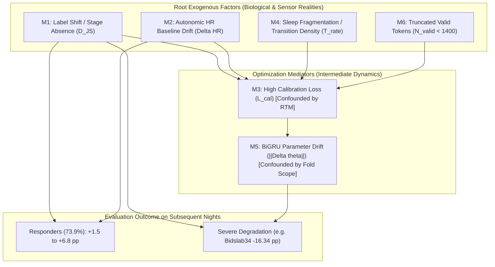

# Concepts Brief: Deconstructing Heterogeneity in Within-Person Sleep Staging Adaptation

* **Author:** jbjoyk
* **Date:** 2026-11-17
* **Status:** Synthesized & Adversarially Audited (Post-EXP-019 Goldfish Review)
* **Governing Baseline:** EXP-019 Confirmatory Outcomes (H-A: Not Supported $\bar{\Delta} = +1.01\text{ pp}$, 95% CI $[-0.17, +1.99]\text{ pp}$; S1: Supported $\bar{\Delta} = +2.73\text{ pp}$; S2: Supported $\bar{\Delta} = +20.32\text{ pp}$; S3: Not Supported $\bar{\Delta} = 0.00\text{ pp}$; 34 Responders [73.9%], 12 Non-Responders [26.1%])

---

## 1. Overview & Problem Context

In EXP-019, within-person supervised adaptation ($FT\text{-}2$) demonstrated two major confirmatory successes alongside a primary threshold shortfall:
1. **Biological Specificity (S1 Supported)**: Fine-tuning on an individual's own 2 calibration nights produces a $+2.73\text{ pp}$ advantage over fine-tuning on another individual's nights ($p = 9.0 \times 10^{-6}$). Fine-tuning on another person actively degrades performance by $-1.72\text{ pp}$ below the zero-shot baseline ($62.86\%$).
2. **Cohort Transfer Value (S2 Supported)**: Training models per-subject from scratch yields an unviable $45.27\%$ Macro-F1 ($+20.32\text{ pp}$ advantage for cohort pre-training).
3. **Primary Threshold Shortfall (H-A Not Supported)**: While 34 of 46 subjects (73.9%) improved with adaptation (Wilcoxon $p = 0.00131$), the mean population gain was $+1.01\text{ pp}$, falling short of the pre-registered $+1.50\text{ pp}$ practical effect threshold. The 95% bootstrap confidence interval ($[-0.17, +1.99]\text{ pp}$) crosses zero due to severe negative outliers:
   - `Bidslab34`: $-16.34\text{ pp}$ ($60.06\% \to 43.72\%$)
   - `Bidslab65`: $-6.57\text{ pp}$ ($47.28\% \to 40.71\%$)
   - `Bidslab10`: $-6.47\text{ pp}$ ($71.53\% \to 65.06\%$)

### The Core Scientific Question
Why does supervised adaptation on $k=2$ earlier nights reliably benefit 74% of individuals (gaining up to $+6.82\text{ pp}$), yet severely degrade staging accuracy in a predictable minority?

This document outlines an audited, causal framework containing six testable, falsifiable mechanisms to explain and predict this heterogeneity using strictly pre-adaptation calibration data, baseline model dynamics, physiological features, and parameter drift—without modifying the locked H-A verdict, altering model architectures, or introducing data leakage.

---

## 2. Causal Architecture of Adaptation Heterogeneity

An adversarial audit across seven specialized lenses established that these six mechanisms are not exchangeable; they form a Directed Acyclic Graph (DAG) separating **exogenous root causes** from **downstream optimization mediators**:

---

## 3. The Six Testable Explanations (Falsifiable Hypotheses)

### Mechanism 1: Prior Probability Shift & Stage Absence (The Primary Root Cause)
* **Biological / Mathematical Mechanism**:
  A person's sleep architecture on early nights is frequently unrepresentative of subsequent nights due to first-night effects, stress, or acute fragmentation. Formally, this is classical **Prior Probability Shift (Label Shift)**: $P_C(y) \ne P_E(y)$ while $P(x|y)$ is approximately invariant. In 4-class Cross-Entropy/RCCLoss, backpropagation updates the classifier emission biases:
  $$b_c \leftarrow b_c + \eta \sum_{t} (y_{t,c} - p_{t,c})$$
  If a calibration stage is absent or suppressed, its emission logit bias is driven downward.
* **Empirical Forensic Evidence (`Bidslab34`, $-16.34\text{ pp}$)**:
  Inspection of `review_package/night_inventory.csv` for `Bidslab34` revealed an extreme stage absence:
  - **Calibration Nights 2 & 3**: Deep sleep fraction was **$0.00\%$** on Night 2 and **$1.34\%$** on Night 3 (Wake $31.5\%$, REM $41.8\%$, Light $26.7\%$).
  - **Evaluation Nights 4 & 5**: Deep sleep rebounded to **$17.65\%$** and **$18.91\%$**!
  - Adapting for 15 epochs on Nights 2 & 3 taught the model that *Deep sleep does not exist for this human*, causing catastrophic collapse when Deep sleep appeared on evaluation nights.
* **Measurable Predictors**:
  - *Post-Hoc Diagnostic*: Jensen-Shannon divergence $D_{\text{JS}}(P_C(y) \parallel P_E(y))$.
  - *Deployment Predictor (100% Leakage-Free)*: Divergence from the population prior $D_{\text{JS}}(P_C(y) \parallel P_{\text{pop}}(y))$ or single-stage absence flag ($\min_c P_C(y=c) < 0.03$).
* **Falsifiable Hypotheses**:
  - **H-D1 (Primary)**: Subject adaptation delta $\Delta_i = FT\text{-}2_i - ZS_i$ is negatively correlated with $D_{\text{JS}}(P_C(y) \parallel P_E(y))$ (Spearman $\rho < -0.40, p < 0.01$).
  - **H-D2 (Deployment Gate)**: Pre-adaptation stage absence ($\min_c P_C(y=c) < 0.03$) accounts for $\ge 60\%$ of severe negative outliers ($\Delta_i < -3.0\text{ pp}$).
* **Required Analysis**: Extract 4-class label marginals from calibration and evaluation nights; compute $D_{\text{JS}}$ and stage fractions; test correlation with $\Delta_i$.
* **Leakage Risk**: Zero for $D_{\text{JS}}(P_C \parallel P_{\text{pop}})$ and class absence flags.
* **Classification**: Primary Exploratory Diagnostic (Candidate Confirmatory Gating Policy).

---

### Mechanism 2: Autonomic State Drift & Inter-Night Physiological Volatility
* **Biological Mechanism**:
  Nocturnal heart rate reflects autonomic tone (sympathetic vs parasympathetic balance). Intersession baseline shifts occur due to alcohol intake, illness, physical exertion, ambient room temperature, or sensor placement tension. When fine-tuning adapts convolutional HR encoder filters to a specific nocturnal heart rate range, it acts as a mismatched filter if the subject's resting heart rate drifts by $> 8\text{ bpm}$ on subsequent nights.
* **Measurable Predictors**:
  - *Post-Hoc Diagnostic*: Shift in nocturnal median heart rate: $|\text{median}(\text{HR}_C) - \text{median}(\text{HR}_E)|$.
  - *Deployment Predictor (Leakage-Free)*: Intra-calibration night-to-night heart rate volatility: $|\text{median}(\text{HR}_{C_1}) - \text{median}(\text{HR}_{C_2})|$ or coefficient of variation $\text{CV}_{\text{HR}} = \sigma_{\text{HR}} / \mu_{\text{HR}}$.
* **Falsifiable Hypotheses**:
  - **H-P1**: $\Delta_i$ is negatively correlated with inter-night physiological drift $|\text{HR}_C - \text{HR}_E|$ (Spearman $\rho < -0.35, p < 0.05$).
  - **H-P2**: Subjects with high calibration HR volatility ($|\text{HR}_{C_1} - \text{HR}_{C_2}| > 6.0\text{ bpm}$) have significantly lower mean adaptation gain ($\bar{\Delta}_{\text{volatile}} < \bar{\Delta}_{\text{stable}}, p < 0.05$).
* **Required Analysis**: Compute nocturnal HR mean, median, IQR, and spectral power across calibration nights from cache `.npz` files; correlate with $\Delta_i$.
* **Leakage Risk**: Zero for intra-calibration volatility.
* **Classification**: Secondary Exploratory.

---

### Mechanism 3: Baseline Model Alignment & Headroom (Adjusting for Regression to the Mean)
* **Biological / Mathematical Mechanism**:
  Subjects whose physiological dynamics closely match the population average achieve high zero-shot performance ($ZS > 70\%$). For these individuals, the zero-shot model is already near its Bayes optimal boundary for wearable signals; fine-tuning on 2 nights provides minimal headroom while increasing overfitting risk. Conversely, subjects with low baseline performance ($ZS < 60\%$) have substantial headroom.
* **Critical Methodological Vulnerability (Regression to the Mean [RTM])**:
  Because $\text{Cov}(ZS_i, FT_i - ZS_i) = -\text{Var}(\epsilon_{ZS}) < 0$ mathematically guaranteed under measurement noise, raw correlation between baseline $ZS$ and gain $\Delta$ is spurious.
* **Measurable Predictors**:
  - Pre-adaptation Cross-Entropy / RCC loss of the zero-shot backbone on calibration nights: $\mathcal{L}_{ZS}(C)$.
  - Average score across baseline and adapted models: $\bar{S}_i = \frac{ZS_i + FT_i}{2}$ (Oldham's Method).
* **Falsifiable Hypotheses**:
  - **H-C1 (Oldham Corrected)**: Correlation between $\bar{S}_i$ and $\Delta_i$ remains significantly negative (confirming genuine headroom rather than RTM artifact).
  - **H-C2**: Pre-adaptation calibration loss $\mathcal{L}_{ZS}(C)$ correlates positively with adaptation gain $\Delta_i$ ($p < 0.05$).
* **Required Analysis**: Evaluate zero-shot backbone loss strictly on calibration nights $C$; compute Oldham's correlation and ANCOVA models.
* **Leakage Risk**: Zero (100% calibration data).
* **Classification**: Secondary Exploratory.

---

### Mechanism 4: Sleep Fragmentation & Boundary Transition Friction
* **Biological Mechanism**:
  High sleep fragmentation (frequent brief arousals, micro-awakenings, or borderline Light/Deep oscillations) generates noisy epoch boundary transitions. Optimizing RCCLoss on a small calibration sample forces the recurrent BiGRU to fit erratic transition boundaries, degrading generalization on subsequent nights with more continuous sleep cycles.
* **Measurable Predictors**:
  - Stage transition density on calibration nights: $T_{\text{rate}}(C) = \text{total stage switches} / \text{total sleep hours}$.
  - Fraction of low-confidence predictions from the zero-shot model on calibration nights: $\text{Frac}(\max_c P(y_t = c) < 0.50)$.
* **Falsifiable Hypotheses**:
  - **H-L1**: Subjects with high calibration transition density ($T_{\text{rate}}(C) > 75\text{th percentile}$) exhibit lower adaptation gains than subjects with continuous sleep cycles ($p < 0.05$).
* **Required Analysis**: Extract transition counts from `night_inventory.csv` for calibration nights; correlate $T_{\text{rate}}$ with $\Delta_i$.
* **Leakage Risk**: Zero.
* **Classification**: Secondary Exploratory.

---

### Mechanism 5: Latent Representation Distortion & Parameter Drift (Accounting for Fold Scope)
* **Mathematical Mechanism**:
  Updating 163,940 parameters on a 2-night batch ($B=2, L=1200$) can rotate shared temporal representations away from universal sequence dynamics.
* **Critical Codebase Conditioning**:
  In Stage D nested validation:
  - **Fold 4** selected `scope=head_gru` (updating only `classifier_head`, BiGRU layer 1, and norm).
  - **Folds 1, 2, 3, 5** selected `scope=all` (updating all 163,940 parameters, including CNN encoders).
  Any parameter drift analysis MUST be stratified by `scope` to prevent bimodal confounding.
* **Measurable Predictor**:
  - Parameter displacement norm: $\|\theta_{FT} - \theta_{ZS}\|_2$ (stratified by trainable scope).
* **Falsifiable Hypotheses**:
  - **H-R1**: Within the `scope=all` cohort, subjects experiencing severe degradation ($\Delta_i < -3.0\text{ pp}$) exhibit significantly higher parameter displacement norms $\|\Delta \theta\|_2$ than stable or improving subjects ($p < 0.01$).
* **Required Analysis**: Compute layer-wise Euclidean weight differences between `state_dict_ref` and adapted checkpoints; correlate with $\Delta_i$ within scope strata.
* **Leakage Risk**: Zero (computed strictly from checkpoint weights).
* **Classification**: Secondary Exploratory (Intermediate Mediator).

---

### Mechanism 6: Token Exposure & Artifact Contamination Asymmetry
* **Physical Mechanism**:
  If calibration nights have short recorded durations ($< 6\text{ hours}$) or high artifact fractions (missing optical PPG), the effective number of valid training tokens is sharply diminished, leading to rapid overparameterized memorization.
* **Empirical Evidence (`Bidslab65`, $-6.57\text{ pp}$)**:
  Total labeled epochs in calibration were only $604 + 606 = 1,210$ epochs (~5 hours/night). When padded to $L=1200$, almost 50% of the mini-batch was masked out.
* **Measurable Predictor**:
  - Total valid calibration tokens: $N_{\text{valid}}(C)$.
* **Falsifiable Hypotheses**:
  - **H-S1**: Adaptation delta variance is significantly higher in subjects with $N_{\text{valid}}(C) < 1400$ epochs compared to subjects with full exposure ($N_{\text{valid}}(C) \ge 1700$ epochs; Levene's test $p < 0.05$).
* **Required Analysis**: Extract valid epoch counts from `night_inventory.csv`; perform Levene's variance ratio test.
* **Leakage Risk**: Zero.
* **Classification**: Secondary Exploratory (Safety Floor).

---

## 4. Multi-Lens Statistical Protocol & Multiplicity Control

* **Sample Size Reality**: $N=46$ outer test subjects; 34 responders ($\Delta > 0$), 12 non-responders ($\Delta < 0$).
* **Multiplicity Protocol**:
  1. **Primary Falsifiable Test**: **H-D1 / Label Shift Severity**:
     Spearman rank correlation between calibration label divergence from population prior $D_{\text{JS}}(P_C \parallel P_{\text{pop}})$ and adaptation delta $\Delta_i$ at $\alpha = 0.05$.
  2. **Secondary Multiplicity Correction**: Secondary tests (H-P2, H-C1 with Oldham correction, H-L1, H-R1 stratified by scope, H-S1) must be adjusted using the **Benjamini-Hochberg False Discovery Rate (FDR)** procedure at $q = 0.05$.

---

## 5. Inventive Solutions (TRIZ Resolutions for Next Protocol Design)

1. **Resolving Plasticity vs. Stability (Catastrophic Forgetting)**:
   - **Elastic Weight Consolidation (EWC)**: Penalize parameter movement using the diagonal Fisher Information matrix from the pre-training population:
     $$\mathcal{L}_{\text{adapt}} = \mathcal{L}_{\text{RCC}}(C) + \frac{\lambda_{\text{EWC}}}{2} \sum_j F_j (\theta_j - \theta_{ZS, j})^2$$
   - **Parameter-Efficient Affine Calibration (PEAC)**: Freeze all CNN and BiGRU weights; fine-tune only GroupNorm affine parameters ($\gamma, \beta$) and classifier biases ($b_c$), dropping trainable parameters from 163,940 to $< 400$.
2. **Resolving Safety Gating vs. Clinical Population Equity**:
   - **Soft Bayesian Uncertainty Mixture of Experts (SBM-MoE)**:
     Rather than a binary reject-or-adapt gate that denies personalization to fragmented sleepers, compute runtime prediction entropy:
     $$P_{\text{final}}(y_t) = w_t P_{FT}(y_t) + (1 - w_t) P_{ZS}(y_t)$$
     where $w_t = \exp(-\tau \cdot \mathcal{H}(P_{FT}(y_t)))$. If the adapted model encounters an ambiguous physiological state, it falls back to the population backbone at runtime.

---

## 6. Goals vs. Non-Goals

### In-Scope Goals
- Author a lightweight audit script `experiments/EXP-019/audit_heterogeneity_mechanisms.py` that extracts the 6 predictors across all 46 subjects from existing CSV/cache/checkpoint artifacts and calculates correlation matrices and FDR-corrected $p$-values.
- Characterize the exact empirical properties of the 12 non-responders (particularly `Bidslab34`, `Bidslab65`, and `Bidslab10`).
- Validate whether pre-adaptation gating ($D_{\text{JS}}(P_C \parallel P_{\text{pop}})$, $N_{\text{valid}}$, $\mathcal{L}_{ZS}(C)$) reliably identifies non-responders using strictly calibration data.

### Out-of-Scope Non-Goals
- **No modification of locked EXP-019 results**: H-A (Not Supported) remains permanent.
- **No NAS or capacity mutations**: Model A remains frozen at 163,940 parameters.
- **No synthetic data generation**: All signals remain real wearable recordings.
- **No post-hoc threshold manipulation**: The $+1.50\text{ pp}$ threshold cannot be altered.
