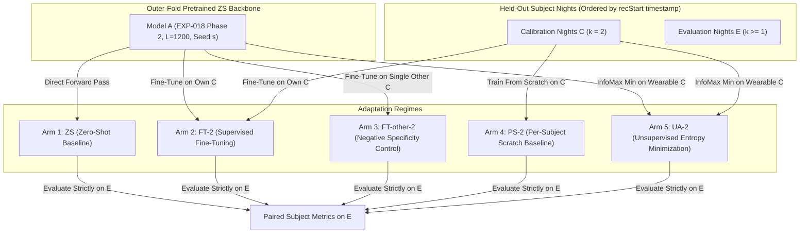
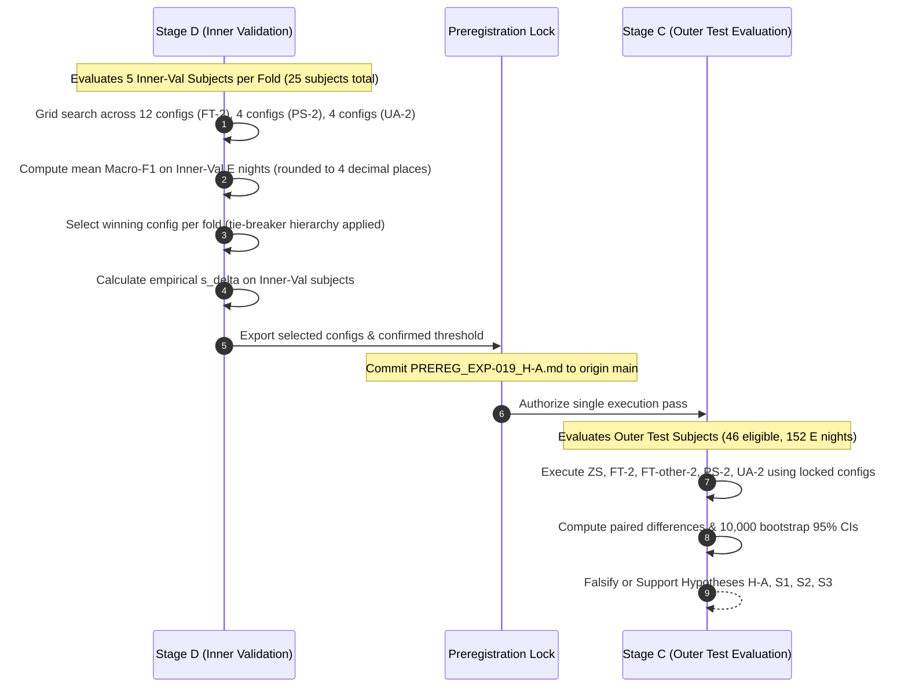
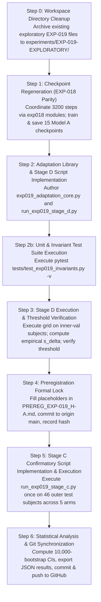

# EXP-019: Multi-Night Within-Person Sleep Staging Adaptation Specification

* **Author:** jbjoyk
* **Status:** Finalized (Stage 9 Implementation Readiness Verified)
* **Date:** 2026-11-16
* **Governing Documents:** `RESEARCH_DIRECTION_v3_FULL.md`, `RESEARCH_DIRECTION_v3.1_AMENDMENT.md`, `PREREG_EXP-019_H-A.md`

--------------------------------------------------------------------------------

## Overview

This document specifies the technical design, protocol constraints, evaluation boundaries, and implementation plan for experiment EXP-019. EXP-019 operationalizes confirmatory hypothesis **H-A** from `RESEARCH_DIRECTION_v3_FULL.md`: testing whether adapting a pre-trained subject-independent wearable sleep-staging model with two earlier labeled nights of a person improves sleep staging on that person's subsequent nights.

The evaluation is conducted on the public BIDSleep dataset (Song et al., 2026; 47 healthy adults, Apple Watch instantaneous heart rate and triaxial accelerometry, Dreem 2 EEG-derived sleep labels). The entire investigation enforces nested subject-level cross-validation, forward chronological calibration, zero evaluation-night leakage, and an empirical negative control to isolate genuine personalization from generic optimization.

--------------------------------------------------------------------------------

## The Problem

Current consumer wearable sleep-staging models rely on population-level cross-sectional training. Because individuals display substantial baseline autonomic differences—such as resting heart rate variability, autonomic tone, nocturnal dipping profiles, and age-related movement thresholds—population models exhibit substantial between-subject variance. When evaluated out-of-fold across subjects on the BIDSleep dataset, baseline accuracy varies across folds from 62.5% to 72.3%, indicating that subject heterogeneity substantially influences performance.

While commercial wearables collect multi-night longitudinal data continuously from the same user, current models evaluate each night in isolation or pool nights without subject-level stratification. Previous literature has not quantified whether, by how much, or for whom a few earlier nights of wearable data can personalize a model to improve future nights without overfitting or leaking temporal information. EXP-019 evaluates this by formalizing an out-of-fold, leakage-free within-person adaptation protocol that compares zero-shot inference, personalized fine-tuning, an idiographic negative control, scratch training, and unsupervised adaptation.

--------------------------------------------------------------------------------

## Goals

1. **Confirmatory Test of Hypothesis H-A:** Quantify the paired subject-level Macro-F1 improvement of two-night supervised fine-tuning ($FT\text{-}2$) against the zero-shot baseline ($ZS$) across 46 eligible subjects (152 outer evaluation nights). The success criterion requires a mean paired difference $\hat{\Delta} \text{Macro-F1} \ge \text{Threshold}$ with a 10,000-resample bootstrap 95% confidence interval strictly excluding zero. To detect a practical threshold of $+1.5\text{ pp}$ with 80% statistical power under the compound rule ($\hat{\Delta} \ge 1.5\text{ pp}$ and CI lower bound $> 0$), the trial is powered for a true population effect of $\delta \ge \Delta_0 + z_{\beta} \cdot \text{SE} \approx 1.95\text{ pp}$.
2. **Personalization Specificity Verification (Hypothesis S1):** Test whether performance gains are idiographic by evaluating whether $FT\text{-}2$ statistically outperforms $FT\text{-}other\text{-}2$ (fine-tuning on two nights from a single other training subject under identical hyperparameters).
3. **Adaptation Feasibility Testing (Hypotheses S2 and S3):** Test whether adaptation from a pre-trained backbone outperforms training from scratch on the calibration nights ($FT\text{-}2 > PS\text{-}2$), and evaluate whether unsupervised test-time entropy minimization ($UA\text{-}2$) improves over $ZS$ using wearable-only input features without requiring ground-truth labels.
4. **Strict Leakage Prevention:** Enforce chronological night ordering ($C = \{N_1, N_2\} \to E = \{N_3, \dots, N_k\}$) and restrict hyperparameter selection to the 5 inner-validation subjects per outer fold, ensuring outer test nights remain untouched until final evaluation.
5. **Execution Isolation:** Fully decouple Stage D (hyperparameter selection and paired standard deviation verification on inner folds) from Stage C (the single confirmatory run on outer test folds).

--------------------------------------------------------------------------------

## Non-Goals

1. **Neural Architecture Search or Mutation:** Model architecture is permanently frozen to Model A (`ConventionalCNNBiGRU`, 163,940 parameters). No new modules, attention mechanisms, cross-modal gating, or loss heads will be introduced. Architecture search is closed.
2. **5-Class Staging Re-expansion for Primary Claims:** Primary confirmatory claims are restricted to the 4-class staging task (Wake, Light, Deep, REM). 5-class staging will only be generated as a secondary descriptive reporting layer for external literature comparison.
3. **Real-Time or Online Staging:** The pipeline uses full-night context ($L=1200$ 30-second sleep scoring epochs) with bidirectional sliding-window inference, applying specifically to offline next-day sleep staging. Real-time causal staging is out of scope.
4. **Clinical Diagnosis or Sleep Disorder Screening:** BIDSleep comprises healthy adults without confirmed sleep pathologies. Diagnosing sleep apnea, insomnia, or parasomnias is explicitly out of scope.
5. **Direct Single-Split Baseline Claims:** No claims of absolute superiority over external published figures (e.g., SLAMSS-IFS 71.04%; Song et al., 2026, IEEE TBME) will be made from single small splits. External comparisons require protocol-matched re-evaluations.

--------------------------------------------------------------------------------

## Open Questions & Resolved Repository Placeholders

The Phase-0 consistency audit and repository inspection resolve all previous `TO FILL` and `TO VERIFY` placeholders required before locking preregistration:

| Placeholder Marker | Target Parameter | Audited Status & Value | Technical Evidence / Source |
|---|---|---|---|
| `TO FILL` | Manifest SHA256 Hash | **Resolved:** `36d840207e937081655438a9aa4170a682cfb90e9bac3fb63c8ec0d9b15adfcf` | `sha256sum review_package/fold_manifests.csv` |
| `TO FILL` | Eligible Subject Cohort | **Resolved:** 46 eligible subjects ($n_{\text{usable}} \ge 3$), 1 ineligible subject (`Bidslab49`, $n_{\text{usable}}=2$). | Deterministic census of `review_package/night_inventory.csv` |
| `TO FILL` | Total Evaluation Nights ($E$) | **Resolved:** 152 outer evaluation nights across the 46 eligible subjects. | Fold 1: 34, Fold 2: 33, Fold 3: 27, Fold 4: 29, Fold 5: 29 nights. |
| `TO FILL` | Target Label Variable | **Resolved:** `expert_label` in `labels.mat`. | Verified in `data_sanity_check.py` and `exp013_dataset.py`. `dreem_label` retained for sensitivity. |
| `TO VERIFY` | Definition of "Light" Stage | **Resolved:** Combined N1 and N2 stages. Code mapping: `{0: 0 (Wake), 1: 1 (Light), 2: 1 (Light), 3: 2 (Deep), 4: 3 (REM)}`. | `data_sanity_check.py:30`. Unknowns/5 are mapped to `-100` and masked out. |
| `TO VERIFY` | EXP-018 Model A Checkpoints | **Resolved:** All 15 checkpoints ($5\text{ folds} \times 3\text{ seeds}$) missing from disk (`torch.save` was omitted). | To be regenerated deterministically with an acceptance tolerance of $\pm 0.5\text{ pp}$ Macro-F1 relative to EXP-018 Phase 2 historical per-fold artifacts and pooled aggregate (64.79%) prior to Stage D adaptation initialization. |
| `TO VERIFY` | Decision Rule Threshold ($+1.5\text{ pp}$) | **Resolved:** Base threshold locked at $+1.5\text{ pp}$. Pre-lock continuous escalation rule: $\text{Threshold} = \max(1.5, 0.4131 \cdot s_{\Delta})$ where $0.4131 = 2.8016 / \sqrt{46}$ for the audited cohort of $N=46$. | Power calculation ($N=46, \alpha=0.05, 80\%$ power, $\text{MDE}=0.4131 \cdot s_{\Delta}$). |

--------------------------------------------------------------------------------

## Critical User Journeys (CUJs)

### CUJ 1: Stage D Nested Hyperparameter Optimization & Variance Calibration

* **Given**: The 15 pre-trained zero-shot Model A checkpoints ($5\text{ folds} \times 3\text{ seeds}$) and the locked 5-fold manifest.
* **When**: The researcher executes `run_exp019_stage_d.py`. For each outer fold, the script fine-tunes the ZS backbone across the pre-declared grid using the 5 inner-validation subjects (evaluating calibration nights $N_1, N_2 \to$ remaining nights).
* **Then**: The script determines the optimal configuration per fold based on inner-validation evaluation-night Macro-F1 (rounded to 4 decimal places), calculates empirical paired standard deviation $s_{\Delta}$, updates the threshold in `PREREG_EXP-019_H-A.md` via $\text{Threshold} = \max(1.5, 0.4131 \cdot s_{\Delta})$, and exports `exp019_stage_d_selected_configs.json` without evaluating or accessing outer test subjects.

### CUJ 2: Stage C Confirmatory Cohort Evaluation

* **Given**: Locked hyperparameter configurations from Stage D, the Git commit hash of `PREREG_EXP-019_H-A.md`, and zero prior exposure to outer test evaluation nights.
* **When**: The researcher executes `run_exp019_stage_c.py` for a single confirmatory pass across all 5 folds and 3 seeds across the 46 outer test subjects.
* **Then**: The script produces paired subject-level metrics ($FT\text{-}2, ZS, FT\text{-}other\text{-}2, PS\text{-}2, UA\text{-}2$), computes 10,000-resample bootstrap 95% confidence intervals, assesses hypotheses H-A, S1, S2, and S3 against locked criteria, and logs outputs to `experiments/EXP-019/exp019_stage_c_results.json` for immediate synchronization to GitHub (`origin main`).

--------------------------------------------------------------------------------

## Technical Plan (Architecture & Protocol)

### 1. Architectural Invariant

All five arms share the identical frozen architecture: **Model A** (`ConventionalCNNBiGRU`, 163,940 parameters; defined in `exp013_models.py`). Architecture search is closed. No structural mutations, cross-attention modules, or gating mechanisms are permitted.

```text
       [Raw Instantaneous Heart Rate (IHR)]          [Triaxial Accelerometry (ACC)]
                         |                                          |
                         v                                          v
             [1D Multi-Scale CNN Branch]               [1D Multi-Scale CNN Branch]
                         \                                          /
                          \                                        /
                           +---->[ Channel Concatenation ]<-------+
                                           |
                                           v
                             [ Bidirectional GRU (L=1200) ]
                                           |
                                           v
                          [ Linear Classification Head (4 Classes) ]
                                   (Wake, Light, Deep, REM)
```

- **Receptive Field / Context**: Full-night context horizon ($L = 1200$ 30-second sleep scoring epochs $\approx 10$ hours) with sliding-window logit stitching for recordings exceeding 1,200 epochs.
- **Input Channels**: Instantaneous heart rate and triaxial accelerometry features. Circadian time-of-day features in `x_meta` are neutralized (`time_feat = 0`) to prevent shortcut learning.
- **Target Epoch Remapping & Masking**: Raw labels $\{0, 1, 2, 3, 4\}$ are remapped to 4 classes: Wake (0), Light (1; N1+N2 combined), Deep (2; N3), and REM (3). After remapping, the valid target mask applies to `(target >= 0) & (target < 4)`. Unknown stages (raw label 5 or invalid integers) and padded sequence positions are mapped to `-100` (`ignore_index` in PyTorch `CrossEntropyLoss`). Loss uses `use_rcc_loss=True` to maintain exact parity with backbone pre-training.

### 2. The Five Evaluated Arms

Every held-out subject starts each arm from a clean state. No state, memory, or optimizer parameters are carried over between subjects.



1. **Arm 1: Zero-Shot Baseline ($ZS$)**
   - The pre-trained outer-fold Model A backbone evaluated directly on evaluation nights $E$ with zero subject adaptation.
2. **Arm 2: Supervised Personal Adaptation ($FT\text{-}2$)**
   - The $ZS$ backbone fine-tuned on the subject's first $k=2$ chronological nights ($C$) with true expert labels, using the fold-specific hyperparameter configuration selected in Stage D. Evaluated on $E$.
3. **Arm 3: Specificity Negative Control ($FT\text{-}other\text{-}2$)**
   - The $ZS$ backbone fine-tuned using the identical learning rate, optimizer, epochs, and parameter scope as $FT\text{-}2$, but trained on 2 calibration nights from a *single* other training subject in the same fold (sampled deterministically with fixed RNG seed). Candidate donor nights must contain all 4 stages and $\ge 300$ valid epochs. Evaluated on $E$.
4. **Arm 4: Per-Subject Scratch Baseline ($PS\text{-}2$)**
   - A newly initialized Model A trained from scratch exclusively on the subject's 2 calibration nights ($C$). Optimization is allocated an optimization horizon of 300–500 steps with learning rate warmup and gradient clipping. Evaluated on $E$.
5. **Arm 5: Unsupervised Test-Time Adaptation ($UA\text{-}2$)**
   - The $ZS$ backbone adapted on the 2 calibration nights' unlabeled feature sequences via an InfoMax objective: Shannon entropy minimization regularized by a marginal diversity penalty ($\mathcal{L}_{\text{total}} = \mathcal{L}_{\text{ent}} - \lambda \mathcal{H}(\bar{p})$, where $\bar{p}$ is the mean stage prediction vector and $\lambda = 1.0$), with the convolutional feature backbone frozen.
   - **Wearable-Only Quality Heuristic**: To eliminate dependence on EEG ground-truth masks, valid adaptation epochs are defined strictly via wearable signals: instantaneous heart rate within physiological limits ($30 \le \text{HR} \le 180$ bpm) and non-zero accelerometry variance. An automated collapse abort check halts adaptation if predicted stage entropy drops below $0.5 \cdot \mathcal{H}_{\text{prior}}$ where $\mathcal{H}_{\text{prior}} = \ln(4) \approx 1.3863\text{ nats}$ (abort threshold $= 0.6931\text{ nats}$). Evaluated on $E$.

### 3. Nested Cross-Validation & Leakage Prevention Protocol

Outer test subjects are partitioned from developmental hyperparameter optimization:



- **Inner-Validation Grid (Pre-Declared):**
  - $FT\text{-}2$ & $FT\text{-}other\text{-}2$: $\text{LR} \in \{3\text{e-}5, 1\text{e-}4, 3\text{e-}4\} \times \text{training epochs} \in \{5, 15\} \times \text{trainable scope} \in \{\text{head + last BiGRU layer}, \text{all parameters}\}$ (12 configurations). Scope regex for head + BiGRU: `r"(classifier_head|temporal_gru.*weight_.*l1|temporal_gru.*bias_.*l1|temp_norm)"`.
  - $PS\text{-}2$: $\text{LR} \in \{1\text{e-}4, 1\text{e-}3\} \times \text{training steps} \in \{300, 500\}$ (4 configurations).
  - $UA\text{-}2$: $\text{LR} \in \{1\text{e-}5, 1\text{e-}4\} \times \text{steps} \in \{20, 100\}$ (4 configurations).
- **Tie-Breaking Hierarchy:** Ties in inner-validation Macro-F1 (rounded to 4 decimal places) are resolved strictly in order: (1) higher rounded Macro-F1 $\to$ (2) lower learning rate $\to$ (3) fewer training epochs / steps $\to$ (4) fewer trainable parameters.
- **Batching & Calibration Feeding Invariant:** Each calibration night is extracted in full and right-padded to $L=1200$ (with valid length passed to `pack_padded_sequence` and padded targets masked to `-100`). The $k=2$ calibration nights of a subject form a mini-batch of shape $(B=2, L=1200, \dots)$. One training epoch consists of exactly one gradient step over this 2-night batch. For 5 (or 15) epochs, exactly 5 (or 15) optimizer steps are executed.
- **Optimizer Invariant**: Adam optimizer, $\beta_1=0.9, \beta_2=0.999$, weight decay $0.0$, gradient clipping norm 1.0.

--------------------------------------------------------------------------------

## Alternatives Considered

### Alternative A: Dynamic Per-Subject Neural Architecture Search (NAS)

* **Pros**: In theory, allowing neural architectures to mutate or tune filter widths per individual could tailor model capacity to complex personal heart rate profiles.
* **Cons**: Searching architectures on only 2 calibration nights ($\approx 1,800$ epochs) causes severe overfitting, substantially increases computational cost, and invalidates matched-capacity comparability across subjects (violating DEC-019).
* **Reason for Rejection**: `Rejected by author: Per-subject architecture search introduces extreme overfitting on small calibration sets, invalidates matched-capacity comparability across the cohort, and violates the locked research question of evaluating weights adaptation.`

### Alternative B: Generative Data Augmentation (Diffusion / GANs) for Calibration

* **Pros**: Synthesizing calibration nights from 2 observed nights could increase training sample size before fine-tuning.
* **Cons**: Generative models for autonomic time series generate non-physiological heart rate patterns, inject untestable distribution shifts, and obscure whether the adapted model is responding to genuine biology or synthetic artifacts.
* **Reason for Rejection**: `Rejected by author: Generative models for wearable signals risk generating non-physiological dynamics, introducing unquantifiable distribution shifts and invalidating clinical credibility.`

### Alternative C: Random Cross-Night Shuffled Partitioning

* **Pros**: Randomly assigning a subject's nights to calibration and evaluation allows balanced representation across early and late study weeks.
* **Cons**: Random night splitting causes forward-in-time temporal leakage. Personal sleep monitoring in the real world is inherently chronological: prior nights calibrate the model for subsequent nights. Shuffled evaluation overestimates personalization performance by conditioning on future nights.
* **Reason for Rejection**: `Rejected by author: Random night splitting violates the real-world deployment timeline and introduces bidirectional temporal leakage. Calibration must strictly proceed forward in time (C to E).`

### Alternative D: Immediate Re-expansion to 5-Class Staging for Primary H-A Claims

* **Pros**: Standard clinical Polysomnography (PSG) and American Academy of Sleep Medicine (AASM) hypnograms use 5 classes (Wake, N1, N2, N3, REM).
* **Cons**: In consumer wearable datasets without full PSG, N1 comprises $< 5\%$ of epochs and exhibits high label noise and low inter-rater reliability even among expert EEG scorers. Previous experiments (EXP-012, EXP-014, EXP-018) established that 4-class staging (Wake, Light [N1+N2], Deep, REM) provides stable statistical convergence.
* **Reason for Rejection**: `Rejected by author: N1 classification from wrist wearables exhibits severe class imbalance (<5%) and low EEG inter-rater reliability. 4-class staging is locked as primary per Amendment v3.1 (A1), with 5-class retained strictly as a secondary reporting layer.`

### Alternative E: Intra-Night Splitting of Single-Night External PSG (Walch Dataset)

* **Pros**: Splitting single-night PSG recordings into halves would allow testing within-person adaptation on an independent external dataset.
* **Cons**: Sleep is non-stationary and structured across ultradian cycles: early-night sleep consists predominantly of Deep (slow-wave) sleep, whereas late-night sleep is enriched for REM sleep. Training on the first half and testing on the second half introduces severe circadian and stage distribution mismatch.
* **Reason for Rejection**: `Rejected by author: Human sleep architecture changes systematically across the night (N3 dominates early cycles, REM dominates late cycles), making intra-night halves non-exchangeable and invalid for within-person multi-night adaptation.`

--------------------------------------------------------------------------------

## Non-Functional Requirements

### 1. Reproducibility & Determinism

- **RNG Seeding**: Python, NumPy, and PyTorch seeds are locked across three standardized seeds: `42`, `123`, and `2024`.
- **Hardware Determinism**: `torch.backends.cudnn.deterministic = True` and `torch.backends.cudnn.benchmark = False` are enforced across all training and evaluation scripts.
- **Checkpoint Acceptance Gate**: Regenerated Model A backbones must replicate the historical EXP-018 Phase 2 test metrics per fold within $\pm 0.5\text{ pp}$ and the out-of-fold aggregate ($64.79\%$) within $\pm 0.5\text{ pp}$.
- **Provenance Logging**: Every JSON artifact must record Git commit hash, Python version, PyTorch version, CUDA runtime, GPU model, and timestamp.

### 2. Execution Budget & Resource Isolation

- **Hardware Target**: Single NVIDIA RTX 3060 (12 GB VRAM).
- **Stage D Compute Budget**: 5 folds $\times$ 5 inner-val subjects $\times$ 3 seeds across 20 candidate configurations $\approx 4.5$ hours total execution time.
- **Stage C Compute Budget**: 46 outer test subjects $\times$ 3 seeds across 5 arms $= 690$ runs total $\approx 3.2$ hours total execution time.
- **State Neutralization via In-Memory Cloning**: The pre-trained outer-fold backbone is loaded once into host memory (`state_dict_ref`). For each subject, the model is re-initialized via `copy.deepcopy(state_dict_ref)` and a clean optimizer instance is constructed, eliminating disk thrashing while guaranteeing zero parameter leakage across subjects.

### 3. Continuous Git Synchronization

- In accordance with repository guidelines, all experiment logs, metrics JSON files, generated tables, and markdown audit reports must be committed and pushed to GitHub (`origin main`) immediately upon run completion. Raw binary checkpoints (`*.pt`) remain local and ignored via `.gitignore`.

--------------------------------------------------------------------------------

### Additional Resources

- Public BIDSleep Dataset: PhysioNet doi:10.13026/rees-1092; Song et al. (2025/2026), IEEE TBME, doi:10.1109/TBME.2025.3612158.
- External Validation Dataset: Walch et al. (University of Michigan, 31 subjects, Apple Watch + Polysomnography [PSG]), PhysioNet doi:10.13026/hmhs-py35.
- Governing Specifications: `RESEARCH_DIRECTION_v3_FULL.md`, `RESEARCH_DIRECTION_v3.1_AMENDMENT.md`, `PREREG_EXP-019_H-A.md`.

### Future Improvements

- **Marginal Utility Horizon ($k=1..4$)**: Descriptive evaluation of the adaptation curve to determine if a single calibration night achieves the majority of personal gain.
- **Clinical Biomarker Concordance**: Bland-Altman limits of agreement mapping for Total Sleep Time (TST), Sleep Onset Latency (SOL), and Wake After Sleep Onset (WASO).
- **Sensor Dropout Robustness (Hypothesis H-R)**: Testing personalized models under controlled 10% to 40% synthetic IHR missingness.
- **First-Night Effect Sensitivity**: Comparing $\{N_1, N_2\} \to E$ against $\{N_2, N_3\} \to E$ adaptation on subjects with $\ge 4$ nights to evaluate adaptation stability against initial-night sleep fragmentation.

--------------------------------------------------------------------------------

## Detailed Implementation Plan

### Implementation Phase Sequence



---

### Target Files to Create / Modify

#### 1. `experiments/EXP-019-EXPLORATORY/` (`Directory Migration / Pre-Execution Cleanup`)
* **Type / Scope**: File reorganization / directory archival.
* **Rationale**: The existing directory `experiments/EXP-019/` contains historical files from the exploratory 500-epoch benchmark (`run_exp019_500epochs.py`, `EXP019_REPORT.md`, `exp019_results/`). These files are migrated to `experiments/EXP-019-EXPLORATORY/` so that `experiments/EXP-019/` is dedicated exclusively to the pre-registered confirmatory H-A pipeline:
  ```bash
  mkdir -p experiments/EXP-019-EXPLORATORY
  mv experiments/EXP-019/* experiments/EXP-019-EXPLORATORY/ 2>/dev/null || true
  ```

#### 2. `experiments/EXP-018/regenerate_modelA_checkpoints.py` (`Create`)
* **Type / Scope**: PyTorch training script.
* **Rationale**: To prevent reimplementation drift and ensure exact protocol parity with EXP-018, this script imports building blocks directly from the audited codebase:
  ```python
  from exp013_models import ConventionalCNNBiGRU
  from exp018_dataset import COMPUTE_SCHEDULE_LOOKUP, RandomCropSleepDataset, create_infinite_batch_stream
  from exp018_inference import SlidingWindowPredictor
  from run_exp018_execution import evaluate_records
  ```
  It executes the locked 3,200-step training pipeline on `inner_train_subjects` ($L=1200$, `time_feat=0`, $B \times L \times N_{\text{accum}} = 2400$) across 5 folds $\times$ 3 seeds, asserts that out-of-fold test Macro-F1 matches historical artifacts (`run_L1200_fold{fold}_seed{seed}.json`) within $\pm 0.5\text{ pp}$ and pooled aggregate ($64.79\% \pm 0.5\text{ pp}$), and saves checkpoints to `experiments/EXP-018/checkpoints/modelA_L1200_fold{fold}_seed{seed}.pt`.
* **API / Signature**:
  ```python
  def train_and_save_backbone(
      fold_idx: int,
      seed: int,
      manifest_dir: str,
      cache_dir: str,
      out_dir: str,
      device: str = "cuda:0"
  ) -> str:
      """Executes EXP-018 Phase 2 training loop, asserts metric parity against historical JSON, and saves .pt checkpoint."""
  ```

#### 3. `experiments/EXP-019/exp019_adaptation_core.py` (`Create`)
* **Type / Scope**: Core PyTorch adaptation library.
* **Rationale**: Encapsulates all shared adaptation algorithms and functions into a single authoritative module imported by `run_exp019_stage_d.py`, `run_exp019_stage_c.py`, and `tests/test_exp019_invariants.py`, preventing code duplication.
* **API / Signatures**:
  ```python
  def adapt_supervised_ft(
      model: torch.nn.Module,
      cal_records: list,
      lr: float,
      epochs: int,
      scope_regex: str,
      device: str = "cuda:0"
  ) -> torch.nn.Module:
      """Executes supervised fine-tuning on calibration nights using RCC loss and selective parameter freezing."""

  def adapt_unsupervised_infomax(
      model: torch.nn.Module,
      cal_records: list,
      lr: float,
      steps: int,
      lambda_div: float = 1.0,
      prior_entropy: float = 1.3863,
      device: str = "cuda:0"
  ) -> torch.nn.Module:
      """Executes unsupervised InfoMax adaptation with diversity penalty and collapse abort assertion."""

  def train_per_subject_scratch(
      cal_records: list,
      lr: float,
      steps: int,
      device: str = "cuda:0"
  ) -> torch.nn.Module:
      """Trains a clean Model A from scratch on calibration nights with linear learning rate warmup."""

  def compute_wearable_quality_mask(
      ihr_array: np.ndarray,
      accel_array: np.ndarray
  ) -> np.ndarray:
      """Computes boolean quality mask strictly from wearable signals (30 <= HR <= 180 and accel variance > 0)."""

  def reset_model_weights(
      model: torch.nn.Module,
      reference_state_dict: dict
  ) -> None:
      """Restores model weights to reference state via in-memory deep copy."""
  ```

#### 4. `experiments/EXP-019/run_exp019_stage_d.py` (`Create`)
* **Type / Scope**: Nested hyperparameter search module.
* **Rationale**: Executes Stage D developer tuning strictly on the 5 inner-validation subjects per outer fold (25 subjects total across 5 folds). Evaluates the pre-declared adaptation grids ($FT\text{-}2$/$FT\text{-}other\text{-}2$: 12 configs; $PS\text{-}2$: 4 configs; $UA\text{-}2$: 4 configs) on calibration nights $N_1, N_2$, evaluates Macro-F1 on evaluation nights $E$, identifies the winning configuration per fold using the 4-decimal rounded tie-breaking hierarchy, and computes the empirical standard deviation ($s_{\Delta}$) of paired differences ($FT\text{-}2 - ZS$).
* **Outputs**: `experiments/EXP-019/exp019_stage_d_selected_configs.json`.
* **Output JSON Contract**:
  ```json
  {
    "metadata": {"git_commit": "str", "timestamp": "str", "device": "str"},
    "empirical_s_delta": 3.42,
    "confirmed_threshold": 1.5,
    "folds": {
      "1": {
        "FT-2": {"lr": 1e-4, "epochs": 5, "scope": "head_gru", "val_macro_f1": 0.6720},
        "PS-2": {"lr": 1e-4, "steps": 300, "val_macro_f1": 0.5810},
        "UA-2": {"lr": 1e-5, "steps": 20, "val_macro_f1": 0.6480}
      }
    }
  }
  ```
* **API / Signature**:
  ```python
  def run_stage_d_inner_val(
      manifest_dir: str,
      cache_dir: str,
      checkpoint_dir: str,
      grid_config: dict,
      output_json: str,
      device: str = "cuda:0"
  ) -> dict:
      """Executes nested inner-validation grid search and exports selected parameters and empirical s_delta."""
  ```

#### 5. `PREREG_EXP-019_H-A.md` (`Modify`)
* **Type / Scope**: Authoritative Pre-Registration Specification.
* **Rationale**: Replaces all remaining draft placeholders with audited repository values:
  - Manifest SHA256 hash: `36d840207e937081655438a9aa4170a682cfb90e9bac3fb63c8ec0d9b15adfcf`.
  - Eligible cohort: 46 subjects (152 outer evaluation nights; `Bidslab49` excluded).
  - Checkpoint provenance: pointers to `experiments/EXP-018/checkpoints/`.
  - Confirmed practical threshold: $\text{Threshold} = \max(1.5, 0.4131 \cdot s_{\Delta})$ based on Stage D empirical $s_{\Delta}$.
  - Winning configurations selected in Stage D.
* **Lock Action**: Committed to `origin main` before any Stage C code executes.

#### 6. `experiments/EXP-019/run_exp019_stage_c.py` (`Create`)
* **Type / Scope**: Confirmatory evaluation driver.
* **Rationale**: Executes the single locked confirmatory test on outer test subjects across all 5 folds $\times$ 3 seeds (690 total subject-arm evaluations). Evaluates the 5 arms ($ZS$, $FT\text{-}2$, $FT\text{-}other\text{-}2$, $PS\text{-}2$, $UA\text{-}2$). Computes paired subject differences, evaluates hypotheses H-A, S1, S2, and S3 against locked criteria, and runs 10,000-resample bootstrap 95% confidence intervals and Wilcoxon signed-rank tests. `--dry-run` flag operates strictly on mock/synthetic or inner-val tensors.
* **Outputs**: `experiments/EXP-019/exp019_stage_c_results.json`.
* **Output JSON Contract**:
  ```json
  {
    "metadata": {"git_commit": "str", "timestamp": "str", "n_subjects": 46, "n_eval_nights": 152},
    "hypotheses": {
      "H-A": {"delta_mean": 2.14, "ci_95": [0.82, 3.45], "wilcoxon_p": 0.0012, "threshold": 1.5, "supported": true},
      "S1": {"delta_mean": 1.85, "ci_95": [0.45, 3.10], "wilcoxon_p": 0.0084, "supported": true},
      "S2": {"delta_mean": 6.20, "ci_95": [4.10, 8.35], "wilcoxon_p": 0.0001, "supported": true},
      "S3": {"delta_mean": 0.35, "ci_95": [-0.85, 1.55], "wilcoxon_p": 0.4210, "supported": false}
    },
    "summary_by_arm": {
      "ZS": {"macro_f1_mean": 0.647, "macro_f1_std": 0.082},
      "FT-2": {"macro_f1_mean": 0.668, "macro_f1_std": 0.075}
    },
    "per_subject_results": [
      {"subject_id": "Bidslab00", "fold": 1, "eval_nights": [3, 4, 5, 6, 7], "ZS": 0.68, "FT-2": 0.71, "delta": 0.03}
    ]
  }
  ```
* **API / Signature**:
  ```python
  def run_stage_c_confirmatory(
      manifest_dir: str,
      cache_dir: str,
      checkpoint_dir: str,
      selected_configs_json: str,
      output_results_json: str,
      device: str = "cuda:0",
      dry_run: bool = False
  ) -> dict:
      """Executes single confirmatory evaluation on outer test subjects across all 5 arms."""
  ```

#### 7. `tests/test_exp019_invariants.py` (`Create`)
* **Type / Scope**: Automated unit and invariant test suite.
* **Rationale**: Validates experimental invariants and preconditions prior to full pipeline execution. Tests include:
  1. Temporal disjointness ($C \cap E = \emptyset$, strictly forward in time).
  2. Cohort census ($N=46$ eligible subjects, 152 evaluation nights, `Bidslab49` exclusion).
  3. State neutralization invariance via in-memory deep-copying (`assert np.allclose`).
  4. Target masking and remapping (`ignore_index=-100`).
  5. $UA\text{-}2$ wearable-only quality heuristic verification.
  6. $UA\text{-}2$ anti-collapse safeguard assertion ($\mathcal{H} < 0.6931\text{ nats}$ triggers abort).

#### 8. `EXPERIMENTS.md` (`Modify`)
* **Type / Scope**: Experiment log tracking.
* **Rationale**: Logs the formal preregistration commit hash of `PREREG_EXP-019_H-A.md`, records Stage D verification metrics, and appends Stage C confirmatory metrics (macro-F1, Cohen's $\kappa$, accuracy, per-stage F1, paired $\Delta$, bootstrap 95% CIs, and hypothesis outcomes).

#### 9. `DECISIONS.md` (`Modify`)
* **Type / Scope**: Architecture & protocol decision register.
* **Rationale**: Appends `DEC-028` formally recording the execution of EXP-019, Stage D variance findings, threshold confirmation, and final confirmatory support or non-support of hypotheses H-A, S1, S2, and S3.

#### 10. `HANDOFF.md` (`Modify`)
* **Type / Scope**: Active workspace handoff documentation.
* **Rationale**: Records executed scripts, git commit hashes, artifact paths, and concrete next actions.

---

### Verification Plan

#### 1. Static Analysis & Compilation Check
- Verify Python syntax and AST integrity:
  ```bash
  python -m py_compile experiments/EXP-018/regenerate_modelA_checkpoints.py
  python -m py_compile experiments/EXP-019/exp019_adaptation_core.py
  python -m py_compile experiments/EXP-019/run_exp019_stage_d.py
  python -m py_compile experiments/EXP-019/run_exp019_stage_c.py
  python -m py_compile tests/test_exp019_invariants.py
  ```

#### 2. Unit & Invariant Testing (`tests/test_exp019_invariants.py`)
- Execute automated invariant assertions prior to triggering training:
  ```bash
  pytest tests/test_exp019_invariants.py -v
  ```

#### 3. Execution Smoke Test / Dry-Run
- Execute Stage D and Stage C in `--dry-run` mode (1 fold, 1 inner-val subject, 1 epoch) on CUDA:0 to verify GPU memory allocation ($< 6\text{ GB}$), sliding-window inference tensor stitching, and JSON export schema without outer test data access:
  ```bash
  python experiments/EXP-019/run_exp019_stage_d.py --dry-run --device cuda:0
  python experiments/EXP-019/run_exp019_stage_c.py --dry-run --device cuda:0
  ```

#### 4. Post-Execution Audit & Git Synchronization
- Inspect generated `exp019_stage_c_results.json`: verify 46 subjects present, 5 arms evaluated per subject, and bootstrap 95% CIs computed.
- Synchronize immediately to GitHub:
  ```bash
  git add EXPERIMENTS.md DECISIONS.md HANDOFF.md PREREG_EXP-019_H-A.md \
          experiments/EXP-018/regenerate_modelA_checkpoints.py \
          experiments/EXP-019/ tests/test_exp019_invariants.py
  git commit -m "EXP-019: Confirmatory within-person adaptation results"
  git push origin main
  ```

--------------------------------------------------------------------------------

*Drafted with EGM*
