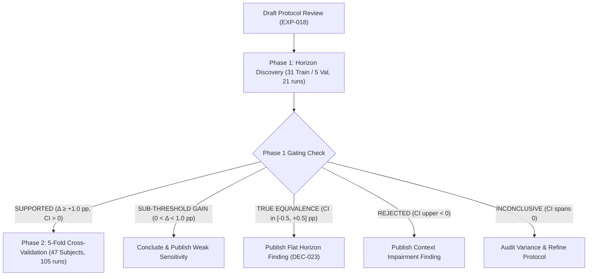

# EXP-018: Context-Horizon Scaling Curve with Data-Coverage Control

- **Author**: Antigravity & Collaborative Research Team
- **Date**: 2026-11-14
- **Status**: DRAFT PROTOCOL (EGM Round 2 Resolved)
- **Target Experiment ID**: EXP-018
- **Primary Architecture**: Model A (`ConventionalCNNBiGRU`, 163,940 parameters; `exp013_models.py`)
- **Execution Mode**: Staged Governed Execution (Phase 1 Discovery $\to$ Phase 2 Full CV)

---

## 1. Problem Statement & Research Context

In EXP-017 ([`DEC-022`](file:///home/rj2826/ai-research/sleep/02.%20A%20Multi-Night%20Instantaneous%20Heart%20Rate%20and%20Accelerometry%20Dataset%20with%20EEG%20Sleep%20Stage%20Labels/DECISIONS.md#L254-L281)), extending sequence training from $T=600$ (5 hours) to $T \le 1200$ (10 hours) was evaluated to test whether sequence truncation caused minority REM sleep under-fitting. On the matched first 600 chronological epoch positions, the primary estimand yielded $\Delta \text{REM Recall} = -0.84\text{ pp}$ [95% CI: $-5.68\text{ pp}, +3.94\text{ pp}$] (`INCONCLUSIVE`), demonstrating that sequence length extension does not rescue early-night REM recall. However, secondary metrics revealed notable gains: overall accuracy rose by $+2.33\text{ pp}$ ($70.47\% \to 72.80\%$), macro-F1 rose by $+0.0210$ ($0.7126 \to 0.7335$), and Deep sleep recall surged by $+8.52\text{ pp}$ ($65.77\% \to 74.57\%$).

Crucially, EXP-017 modified two confounding factors simultaneously:
1. **Context Horizon Length ($L$)**: The recurrent BiGRU unrolled over up to 1,200 timesteps rather than 600.
2. **Circadian Data Coverage**: The $T \le 1200$ condition observed late-night sleep cycles (Hours 6–10), whereas $T=600$ was strictly constrained to early-night sleep (Hours 1–5).

**EXP-018 isolates these factors**. By extracting random crops from throughout the full night during training, models at all context lengths ($L$) observe identical nocturnal data distributions and circadian phases. This cleanly decouples temporal receptive field length from data coverage.

---

## 2. Goals & Non-Goals

### Goals
- **Map the Context-Horizon Scaling Curve**: Quantify empirical sleep staging performance (macro-F1, Cohen's $\kappa$, per-class F1) as a function of context length $L \in \{1, 20, 60, 120, 300, 600, 1200\}$ epochs (30 seconds to 10 hours).
- **Identify Saturation Threshold ($L^*$)**: Estimate the minimal context length beyond which sequence modeling yields diminishing returns.
- **Isolate Temporal Context from Circadian Prior**: Prevent shortcut learning by neutralizing explicit time-of-day features in `x_meta`, forcing the recurrent backbone to rely exclusively on physiological dynamics.
- **Standardize Full-Night Inference**: Predict all target epochs across entire nights via a uniform sliding-window inference and logit stitching engine.

### Non-Goals
- **Architectural Modification**: No changes to Model A's CNN encoders, channel counts, or BiGRU hidden dimensions ($163,940$ parameters).
- **Benchmarking Model E (SleepAdaptiveNet)**: Model E remains frozen per DEC-020/022.
- **Modifying Preprocessing or Raw Sampling**: Feature extraction remains fixed to audited cache `prep_57738d534b` (fingerprint `8ae7a916a4cd5709`).

---

## 3. Experimental Design & Phased Execution

To prevent unmitigated resource consumption and verify pipeline stability before large-scale benchmarking, EXP-018 is structured into two sequential phases:

### Phase 1: Rapid Horizon Discovery & Gating (21 Runs)
- **Cohort**: Standard audited partition (31 train subjects, 160 nights; 5 validation subjects, 28 nights; split hash `bf33573623f47f3f`).
- **Held-Out Test Set**: 11 test subjects strictly locked (`split_role='val'`). Zero test leakage.
- **Conditions**: 7 context lengths $L \in \{1, 20, 60, 120, 300, 600, 1200\} \times 3 \text{ seeds } (42, 123, 2024) = 21\text{ runs}$.
- **Runtime Budget**: $\approx 1.5$ hours on NVIDIA RTX 3060.
- **Objective**: Validate the curve shape, verify sliding-window reconstruction, and establish whether $L \ge 60$ provides statistically detectable gains over short contexts.

### Phase 1b: Exploratory Circadian Ablation (9 Runs, Post-Gating)
- **Scope**: Executed following Phase 1 primary discovery only if Phase 1 passes gating or produces actionable insights.
- **Conditions**: $L \in \{1, 60, 600\} \times 3 \text{ seeds} = 9\text{ runs}$ with active `time_feat` (`x_meta[:, :, 2]`) to measure explicit circadian timing contribution.

### Phase 2: Cohort-Wide Generalization (105 Runs)
- **Cohort**: 5-fold cross-validation across all 47 subjects (246 usable nights), reusing exact partition manifests from [`experiments/EXP-014/EXP014_MANIFESTS/fold_{1..5}.json`](file:///home/rj2826/ai-research/sleep/02.%20A%20Multi-Night%20Instantaneous%20Heart%20Rate%20and%20Accelerometry%20Dataset%20with%20EEG%20Sleep%20Stage%20Labels/experiments/EXP-014/EXP014_MANIFESTS/fold_1.json).
- **Gating Prerequisite**: Authorized only if Phase 1 demonstrates a statistically significant effect ($\Delta \text{Macro-F1} \ge +1.0\text{ pp}$ with 95% CI excluding zero).
- **Runs**: $7 L \times 5 \text{ folds} \times 3 \text{ seeds} = 105\text{ runs}$.

---

## 4. Algorithmic Specifications

### 4.1 Training Window Extraction (Random Crops)
- For recording with native length $N$ and target context length $L$:
  - If $N > L$: Start offset sampled uniformly $s \sim \text{Uniform}(0, N - L)$. Crop span $[s, s + L]$ extracted.
  - If $N \le L$: Sequence extracted from $0$ to $N$, padded on the right with zeros up to $L$. Padded timesteps marked with `mask=False` and target $y=-100$. Native length $N$ passed to `pack_padded_sequence` (strictly preventing tail contamination per DEC-022).
- Dynamic worker seeding: PyTorch `DataLoader` configured with `worker_init_fn` ensuring distinct random crop streams across parallel workers.

### 4.2 Compute Invariant & Batch Scheduling
To prevent confounding context length with gradient noise, optimizer step divergence, or IPC bottlenecks:
- **Optimization Budget**: Fixed total steps $S_{\text{total}} = 3,200$ optimizer updates (`optimizer.step()`), executed via an infinite cyclic `DataLoader` stream.
- **Effective Token Exposure Invariant**: Exactly $K = 2,400$ epochs per optimizer step across all $L$.
- **Exact Configuration Lookup Table**:

| Context Length ($L$) | Batch Type | Micro-Batch Size ($B$) | Grad Accum ($N_{\text{accum}}$) | Effective Tokens / Step ($B \cdot L \cdot N_{\text{accum}}$) |
| :---: | :---: | :---: | :---: | :---: |
| $L=1200$ | Trajectory | 2 | 1 | 2,400 |
| $L=600$ | Trajectory | 4 | 1 | 2,400 |
| $L=300$ | Trajectory | 4 | 2 | 2,400 |
| $L=120$ | Trajectory | 4 | 5 | 2,400 |
| $L=60$ | Trajectory | 8 | 5 | 2,400 |
| $L=20$ | Trajectory | 12 | 10 | 2,400 |
| $L=1$ | Flat Epoch | 240 | 10 | 2,400 |

*Note on $L=1$*: Flat epoch batching ($B=240, N_{\text{accum}}=10$) avoids the 480,000-pass IPC bottleneck of trajectory slicing while maintaining the exact token exposure invariant ($2,400$ tokens/step over $3,200$ steps $= 7,680,000$ tokens total).
- **Optimizer**: Adam ($\text{lr} = 10^{-4}$, weight decay 0.0, $\beta_1=0.9, \beta_2=0.999$, clip grad norm 1.0).

### 4.3 Input Feature Isolation (Circadian Neutralization)
In [`exp013_models.py`](file:///home/rj2826/ai-research/sleep/02.%20A%20Multi-Night%20Instantaneous%20Heart%20Rate%20and%20Accelerometry%20Dataset%20with%20EEG%20Sleep%20Stage%20Labels/exp013_models.py#L69-L72), `x_meta` contains 5 channels: `[raw_hr_rate, motion_count, time_feat, cov_hr, cov_motion]`.
- **Primary Series**: `time_feat` (`x_meta[:, :, 2]`) is explicitly zeroed out (`time_feat = 0.0`). The network is denied direct access to chronological time-in-night, ensuring performance across $L$ reflects physiological sequence context.
- **Ablation Series (Phase 1b)**: $L \in \{1, 60, 600\}$ with active `time_feat` to quantify standalone circadian prior benefit.

### 4.4 Sliding-Window Full-Night Inference Engine
Full-night evaluation reconstructs dense predictions for all $N$ epochs of every test night without data loss:

#### Case 1: Short Night ($N \le L$)
- Right-pad the full recording $[0, N)$ with zeros up to length $L$.
- Pass native sequence length $N$ to `pack_padded_sequence` (zero padding leakage per DEC-022).
- **Bypass margin discarding entirely** ($m=0$). Forward pass yields softmax probabilities $P \in \mathbb{R}^{L \times 4}$. Retain slice $P[0:N]$ directly with weight 1.0: $\hat{y}_t = \arg\max_c P_{t, c}$.

#### Case 2: Standard Night ($N > L$)
- **Window Geometry**: Window length $W = L$, sliding stride $S = \max(1, \lfloor L / 2 \rfloor)$.
- **Margin Fraction**: $m = \lfloor 0.25 \cdot L \rfloor$ on left and right for $L \ge 20$. For $L=1$, $m=0, S=1$.
- **Dense Reconstruction Algorithm**:
  1. Initialize accumulators: `prob_sum = np.zeros((N, 4))` and `counts = np.zeros(N)`.
  2. Window start indices: $W_{\text{starts}} = \text{unique}([0, S, 2S, \dots] \cup [\max(0, N - L)])$.
  3. For each window start $w \in W_{\text{starts}}$:
     - Slice input $[w, w + L]$ and perform forward pass yielding softmax probabilities $P \in \mathbb{R}^{L \times 4}$.
     - **Boundary start ($w = 0$)**: Accumulate slice $P[0 : L - m]$ into `prob_sum[0 : L - m]` and increment `counts[0 : L - m]`.
     - **Boundary end ($w = N - L$)**: Accumulate slice $P[m : L]$ into `prob_sum[w + m : N]` and increment `counts[w + m : N]`.
     - **Interior windows ($0 < w < N - L$)**: Accumulate central slice $P[m : L - m]$ into `prob_sum[w + m : w + L - m]` and increment `counts[w + m : w + L - m]`.
  4. Final hypnogram: $\hat{y}_t = \arg\max_{c \in \{0, 1, 2, 3\}} (\text{prob\_sum}[t, c] / \text{counts}[t])$.

---

## 5. Baselines

1. **Non-Recurrent Baseline ($L=1$)**: Model A evaluated with single-epoch input ($L=1$). Because BiGRU recurrence cannot unroll over length 1, temporal recurrence is bypassed, establishing the uncontextualized classification floor.
2. **Empirical Circadian Prior**: Hourly stage prior histogram $P(\text{Stage} \mid \text{Hour})$ computed on training folds, predicting based purely on time-in-night.
3. **SLAMSS-IFS Baseline**: 666k parameter SLAMSS-IFS paper-specification model ([`SLAMSS_IFS`](file:///home/rj2826/ai-research/sleep/02.%20A%20Multi-Night%20Instantaneous%20Heart%20Rate%20and%20Accelerometry%20Dataset%20with%20EEG%20Sleep%20Stage%20Labels/experiments/EXP-005/slamss_ifs_baseline.py#L262)) evaluated at $L=1200$ across identical splits as a frozen external comparator (0 new training runs required).

---

## 6. Pre-Registered Metrics & Mathematical Estimands

### Primary Estimands
1. **Pairwise Horizon Gain**:
   $$\Delta \text{Macro-F1}_{(600 \text{ vs } 60)} = \text{Macro-F1}(L=600) - \text{Macro-F1}(L=60)$$
2. **Parametric Saturation Curve Fit**:
   Fit an exponential saturation curve across subject-mean macro-F1 values:
   $$F_1(L) = A - B e^{-k L}$$
   Saturation threshold $L^*$ is defined as the context length where the model achieves 95% of the total asymptotic improvement from baseline:
   $$F_1(L^*) = A - 0.05 B \implies e^{-k L^*} = 0.05 \implies L^* = \frac{\ln(20)}{k} \approx \frac{2.996}{k}$$

### Secondary Metrics
- Overall Accuracy, Cohen's $\kappa$, MCC.
- Per-class F1-scores ($F_{1, \text{Wake}}, F_{1, \text{Light}}, F_{1, \text{Deep}}, F_{1, \text{REM}}$).
- Boundary Error Rate (fraction of misclassifications at transition epochs $y_t \neq y_{t-1}$).
- Stratified performance by nocturnal quartile (Hours 1–2, 3–4, 5–6, 7–8).

### Clinical Polysomnography Metrics
Implemented via `ClinicalHypnogramEvaluator` operating on continuous per-night sequences ($N$ epochs, Total In-Bed Time $\text{TIB} = N \times 0.5\text{ min}$):
- **Total Sleep Time (TST)**: $\text{TST} = \sum_{t=1}^N \mathbb{I}[y_t \in \{\text{Light}, \text{Deep}, \text{REM}\}] \times 0.5\text{ min}$.
- **Sleep Onset Latency (SOL)**: Time from recording start to first 3 consecutive sleep epochs ($1.5$ minutes of continuous sleep). If no sleep occurs: $\text{SOL} = \text{TIB}$.
- **Wake After Sleep Onset (WASO)**: Total wake minutes between sleep onset and final sleep epoch. If no sleep occurs: $\text{WASO} = 0.0\text{ min}$.
- **Sleep Efficiency (SE)**: $\text{SE} = (\text{TST} / \text{TIB}) \times 100\%$. If $\text{TIB} = 0$: $\text{SE} = 0.0\%$.
- **Stage Durations**: Absolute duration (minutes) and relative percentage for Deep and REM sleep.

---

## 7. Statistical Decision Framework

Statistical inference treats the **subject as the independent unit of analysis** ($N=5$ in Phase 1; $N=47$ in Phase 2) with a paired cluster bootstrap ($B=1000$ resamples) reporting 95% confidence intervals.

### Pre-Registered Decision Matrix
| Category | Mathematical Criteria | Scientific Interpretation & Operational Routing |
| :--- | :--- | :--- |
| **SUPPORTED (Context Benefit)** | $\Delta \text{Macro-F1}_{(600 \text{ vs } 60)} \ge +1.0\text{ pp}$ AND $95\%\text{ CI}_{\text{lower}} > 0.0\text{ pp}$ | Long context significantly improves wearable sleep staging. **Phase 2 CV is AUTHORIZED**. |
| **SUB-THRESHOLD GAIN** | $95\%\text{ CI}_{\text{lower}} > 0.0\text{ pp}$ AND $0.0 < \Delta < +1.0\text{ pp}$ | Real but weak statistical context gain. **Conclude at Phase 1**; document weak context sensitivity. |
| **TRUE EQUIVALENCE (Flat Horizon)** | $95\%\text{ CI} \subset [-0.5\text{ pp}, +0.5\text{ pp}]$ | Receptive field horizon saturates at or before 30 minutes ($L \le 60$). **Conclude at Phase 1**; publish flat horizon (`DEC-023`). |
| **SUB-THRESHOLD IMPAIRMENT** | $95\%\text{ CI}_{\text{upper}} < 0.0\text{ pp}$ AND $-1.0\text{ pp} < \Delta < 0.0\text{ pp}$ | Real but weak context degradation. **Conclude at Phase 1**; document slight over-smoothing. |
| **REJECTED (Context Impairment)** | $\Delta \le -1.0\text{ pp}$ AND $95\%\text{ CI}_{\text{upper}} < 0.0\text{ pp}$ | Long context degrades performance. **Conclude at Phase 1**; document severe over-smoothing. |
| **INCONCLUSIVE (Insufficient Precision)** | Complement of above (e.g., $95\%\text{ CI}$ spans $0.0$ and is not contained in $[-0.5\text{ pp}, +0.5\text{ pp}]$) | High subject variance prevents definitive conclusion. **Conclude at Phase 1**; audit variance and window geometry. |

---

## 8. Alternatives Considered

| Alternative Formulations | Assessment & Rejection Rationale |
| :--- | :--- |
| **Continuous Streaming BiGRU State Carryover** | Rejected: Carrying hidden states across nocturnal chunks creates sequential data loading bottlenecks in distributed training and complicates multi-night cross-validation shuffling. |
| **Transformer / State-Space Models (S4/Mamba)** | Rejected: Introducing a new backbone architecture conflates context scaling with model capacity and architectural inductive biases. EXP-018 isolates context horizon in the established baseline. |
| **Immediate Monolithic 105-Run CV** | Rejected: Running all 105 runs upfront without Phase 1 validation risks wasting ~12 GPU hours if random cropping or sliding-window margin parameters require tuning. |
| **Fixed Start-Offset Prefix Cropping (EXP-017 style)** | Rejected: Slicing from $t=0$ confounds context length with nocturnal coverage, systematically starving short-$L$ models of late-night REM sleep. |

---

## 9. Risks & Mitigations

1. **Risk: Gradient Noise & Batch Size Divergence**  
   *Mitigation*: Fixed token exposure ($K=2,400$ epochs/step) via explicit $(B, N_{\text{accum}})$ scheduling ensures identical gradient accumulation variance across all $L$.
2. **Risk: Circadian Shortcut Learning**  
   *Mitigation*: Explicitly zeroing out `time_feat` in `x_meta` prevents the network from relying on absolute time-of-day.
3. **Risk: Boundary Artifacts & Short-Night Failures in Sliding Inference**  
   *Mitigation*: Explicit branching: recordings with $N \le L$ bypass margin discarding and use zero-padding with `seq_lens=N`. Standard recordings use asymmetric boundary anchoring and logit averaging.
4. **Risk: Compute Overrun & GPU Contention**  
   *Mitigation*: Two-phase execution bounds initial compute to 1.5 hours, requiring explicit verification gate before full CV.
5. **Risk: $L=1$ Dataloader IPC Bottleneck**  
   *Mitigation*: Decoupled flat epoch batching ($B=240, N_{\text{accum}}=10$) cuts forward passes from 480k to 32k, running in $<3$ minutes per seed.

---

## 10. Target Scope & File Boundaries

### Files to Create
- [`exp018_dataset.py`](file:///home/rj2826/ai-research/sleep/02.%20A%20Multi-Night%20Instantaneous%20Heart%20Rate%20and%20Accelerometry%20Dataset%20with%20EEG%20Sleep%20Stage%20Labels/exp018_dataset.py): `RandomCropSleepDataset` with dynamic uniform sampling and right-padding protection.
- [`exp018_inference.py`](file:///home/rj2826/ai-research/sleep/02.%20A%20Multi-Night%20Instantaneous%20Heart%20Rate%20and%20Accelerometry%20Dataset%20with%20EEG%20Sleep%20Stage%20Labels/exp018_inference.py): `SlidingWindowPredictor` with short-night bypass, margin discard, and logit stitching.
- [`run_exp018_execution.py`](file:///home/rj2826/ai-research/sleep/02.%20A%20Multi-Night%20Instantaneous%20Heart%20Rate%20and%20Accelerometry%20Dataset%20with%20EEG%20Sleep%20Stage%20Labels/run_exp018_execution.py): Governed execution script for Phase 1 and Phase 2.
- [`tests/test_exp018_pipeline.py`](file:///home/rj2826/ai-research/sleep/02.%20A%20Multi-Night%20Instantaneous%20Heart%20Rate%20and%20Accelerometry%20Dataset%20with%20EEG%20Sleep%20Stage%20Labels/tests/test_exp018_pipeline.py): Pre-registered unit test suite containing:
  - `test_random_crop_sampling_and_padding`: verifies start offsets in $[0, N-L]$, right-padding for $N \le L$, and `seq_len` propagation.
  - `test_token_exposure_invariant`: verifies $(B, L, N_{\text{accum}})$ yields exactly 2,400 tokens/step across all $L$.
  - `test_sliding_inference_short_night`: verifies $N \le L$ produces exact $N$-length hypnograms without index errors or margin drops.
  - `test_sliding_inference_full_night`: verifies complete nocturnal coverage (counts $\ge 1$) for arbitrary $N > L$.
  - `test_circadian_neutralization`: verifies `x_meta[:, :, 2] == 0.0` in primary condition.
  - `test_clinical_metrics_synthetic`: verifies TST, SOL, WASO, SE on known synthetic hypnograms and zero-sleep edge cases.

### Files to Read / Modify
- [`evaluator.py`](file:///home/rj2826/ai-research/sleep/02.%20A%20Multi-Night%20Instantaneous%20Heart%20Rate%20and%20Accelerometry%20Dataset%20with%20EEG%20Sleep%20Stage%20Labels/evaluator.py): Add `ClinicalHypnogramEvaluator` class for TST, SOL, WASO, and SE.
- [`exp013_models.py`](file:///home/rj2826/ai-research/sleep/02.%20A%20Multi-Night%20Instantaneous%20Heart%20Rate%20and%20Accelerometry%20Dataset%20with%20EEG%20Sleep%20Stage%20Labels/exp013_models.py): Read `ConventionalCNNBiGRU` (unchanged).

### Artifact Outputs
- `experiments/EXP-018/phase1_results/`: Phase 1 metrics, curves, and summary CSVs.
- `experiments/EXP-018/phase2_results/`: Phase 2 CV fold results (if gated).
- `experiments/EXP-018/EXP018_FINAL_REPORT.md`: Comprehensive evaluation report.
