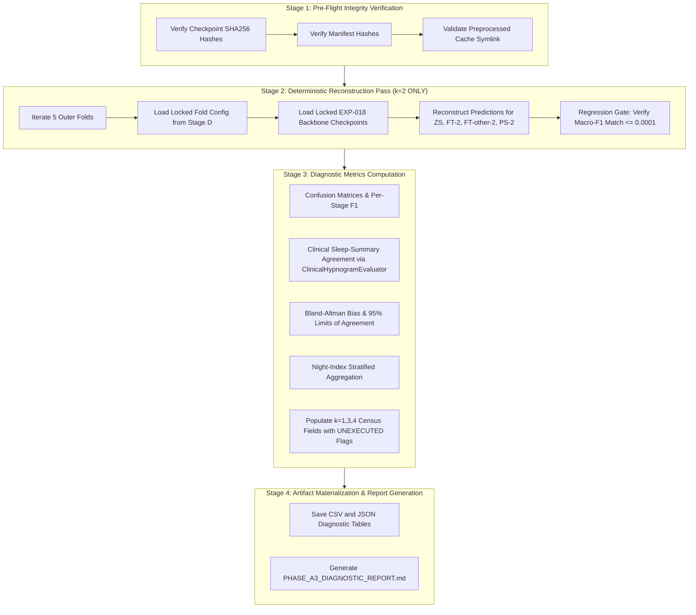

# Design Specification: EXP-019 Phase A3 Diagnostic Extraction and Reconstruction

**Document ID:** `EXP019-DES-A3-001`  
**Author:** Antigravity Research Engineering  
**Date:** 2026-11-17  
**Status:** RESOLVED / SCOPE-LOCKED (Approved with Strict Scope Reduction)  
**Target Script:** `experiments/EXP-019/extract_exp019_phase_a3_outputs.py`  
**Governing Documents:**  
- `RESEARCH_DIRECTION_v4_FULL.md` (Authoritative Direction)  
- `PREREG_EXP-019_H-A.md` (Locked at commit `4dff5b7`)  
- `DECISIONS.md` (`DEC-029`, `DEC-030`)  
- `experiments/EXP-019/ROADMAP_V4_FULL_AUDIT_REPORT.md` (Master Roadmap Audit)  
- `experiments/EXP-019/A3_EXTRACTION_GOVERNANCE_REVIEW_REPORT.md` (Governance Review Authority)  

---

## 1. Objective

The objective of Phase A3 is to complete the descriptive diagnostic write-down for EXP-019 as preregistered in `PREREG_EXP-019_H-A.md` (Section 2, line 27). 

Per the authoritative governance review ([`A3_EXTRACTION_GOVERNANCE_REVIEW_REPORT.md`](file:///home/rj2826/ai-research/sleep/02.%20A%20Multi-Night%20Instantaneous%20Heart%20Rate%20and%20Accelerometry%20Dataset%20with%20EEG%20Sleep%20Stage%20Labels/experiments/EXP-019/A3_EXTRACTION_GOVERNANCE_REVIEW_REPORT.md)), Phase A3 is strictly limited to:
**$k=2$ diagnostic recovery + locked-artifact re-analysis.**

Specifically, this specification defines the exact, auditable procedure to:
1. Formally record the $k \in \{1, 2, 3, 4\}$ calibration learning curve status, distinguishing the executed $k=2$ confirmatory anchor from the unexecuted/unrecoverable $k \in \{1, 3, 4\}$ conditions;
2. Execute a deterministic recovery pass for the unpersisted intermediate predictions of the already-executed $k=2$ Stage C models (`ZS`, `FT-2`, `FT-other-2`, `PS-2`);
3. Generate four-class confusion matrices and per-stage F1 scores (Wake, Light, Deep, REM) for the valid executed $k=2$ model arms;
4. Extract clinical sleep-summary agreement statistics (TST, SOL, WASO, SE, REM%, Deep%) and Bland-Altman limits of agreement against ground-truth polysomnographic/EEG labels for the executed $k=2$ models;
5. Stratify performance across outer evaluation-night index for the executed $k=2$ models.

**Strict Governance Invariant:** No new adaptation, fine-tuning, or model training passes for $k \in \{1, 3, 4\}$ are authorized. Phase A3 does not conduct new experimentation.

---

## 2. Scope

### In-Scope
- **Re-Analysis of Preserved Metrics:** Computing secondary statistics, bootstrap confidence intervals, and Wilcoxon signed-rank tests directly from locked CSV tables (`exp019_subject_metrics.csv`, `exp019_summary.csv`).
- **Deterministic Reconstruction Pass ($k=2$ ONLY):** Re-running the exact frozen Stage C evaluation code (`run_exp019_stage_c.py`) with fixed seeds (`[42, 123, 2024]`) to recover discarded intermediate epoch predictions and whole-night hypnograms for `ZS`, `FT-2`, `FT-other-2`, and `PS-2` on evaluation nights $E$ ($N=152$).
- **$k=2$ Diagnostic Outputs:** Generating $4 \times 4$ confusion matrices, stage-specific metrics with Benjamini-Hochberg False Discovery Rate (FDR at $q=0.05$) correction, Bland-Altman sleep-summary agreement statistics via [`ClinicalHypnogramEvaluator`](file:///home/rj2826/ai-research/sleep/02.%20A%20Multi-Night%20Instantaneous%20Heart%20Rate%20and%20Accelerometry%20Dataset%20with%20EEG%20Sleep%20Stage%20Labels/evaluator.py), and night-index breakdown.
- **Formal Status Documentation for $k \in \{1, 3, 4\}$:** Documenting the theoretical cohort census for $k \in \{1, 3, 4\}$ while formally marking performance metrics as `UNEXECUTED_IN_EXP019`.
- **Materialization of Artifacts:** Exporting 5 structured CSV/JSON artifacts and generating the final synthesis report [`PHASE_A3_DIAGNOSTIC_REPORT.md`](file:///home/rj2826/ai-research/sleep/02.%20A%20Multi-Night%20Instantaneous%20Heart%20Rate%20and%20Accelerometry%20Dataset%20with%20EEG%20Sleep%20Stage%20Labels/experiments/EXP-019/PHASE_A3_DIAGNOSTIC_REPORT.md).

### Out-of-Scope (Strictly Prohibited)
- **NO new adaptation or fine-tuning runs for $k \in \{1, 3, 4\}$.** Running fine-tuning on $k \ne 2$ constitutes 414 new training jobs and violates the anti-premature training gate of `RESEARCH_DIRECTION_v4_FULL.md`.
- **NO hyperparameter transfer or tuning for $k \ne 2$.** Stage D evaluated hyperparameters strictly for $k=2$; transferring them to $k \in \{1, 3, 4\}$ is un-preregistered training.
- **NO alteration of locked confirmatory numerical artifacts** (`exp019_stage_c_results.json`, `exp019_subject_metrics.csv`, `exp019_summary.csv`).
- **NO modification of the locked preregistration** (`PREREG_EXP-019_H-A.md`) or its decision rules.
- **NO execution or reporting of `UA-2`** as valid adaptation evidence (locked as an invalidated implementation no-op per `DEC-030`).
- **NO post-hoc subject exclusion, threshold escalation, or subgroup pruning.**

---

## 3. Locked Inputs and Provenance Authority

Every output produced by this extraction must trace directly to one of the following immutable inputs:

| Input Asset | Path / Source | Integrity Check / Hash |
| :--- | :--- | :--- |
| **Preregistration** | `PREREG_EXP-019_H-A.md` | Commit `4dff5b7` |
| **Primary Stage C Results** | `experiments/EXP-019/exp019_stage_c_results.json` | 46 outer test subjects, 152 evaluation nights |
| **Subject Metrics CSV** | `experiments/EXP-019/exp019_subject_metrics.csv` | Confirmatory macro-F1 baselines |
| **Summary Metrics CSV** | `experiments/EXP-019/exp019_summary.csv` | Arm mean and std baselines |
| **Stage D Selected Configs** | `experiments/EXP-019/exp019_stage_d_selected_configs.json` | Locked fold-level hyperparameters (for $k=2$) |
| **Backbone Checkpoints** | `experiments/EXP-018/checkpoints/modelA_L1200_fold{1..5}_seed{42,123,2024}.pt` | 15 locked checkpoints ($5\text{ folds} \times 3\text{ seeds}$) |
| **Subject Fold Manifests** | `experiments/EXP-014/EXP014_MANIFESTS/fold_{1..5}.json` | SHA256: `36d840207e937081655438a9aa4170a682cfb90e9bac3fb63c8ec0d9b15adfcf` |
| **Preprocessed Data Cache** | `cache/prep_57738d534b/` | Standardized IHR + accelerometry records (`.npz`) |

---

## 4. Subject Eligibility and Night Partitioning Rules

### 4.1 Cohort Census
- Total outer test subjects: Exactly 46 eligible subjects satisfying $n_{\text{usable}} \ge 3$ nights.
- Single excluded subject: `Bidslab49` ($n_{\text{usable}} = 2$), excluded because reserving $k=2$ calibration nights leaves zero evaluation nights.

### 4.2 Chronological Partitioning for $k=2$
Night ordering for each subject is strictly chronological based on `recStart` / night index:
- $\text{Nights}(s) = [n_1, n_2, \dots, n_N]$, sorted by night index.
- Calibration set ($k=2$): $C_2 = [n_1, n_2]$.
- Evaluation set ($k=2$): $E_2 = [n_3, \dots, n_N]$ ($152\text{ nights}$ across $46\text{ subjects}$).
- **Zero-Overlap Invariant:** $C_2 \cap E_2 = \emptyset$.
- **Fair Baseline Invariant:** $ZS$, $FT\text{-}2$, $FT\text{-}other\text{-}2$, and $PS\text{-}2$ are evaluated on the exact same evaluation nights $E_2$.

### 4.3 Calibration Depth Classification ($k \in \{1, 2, 3, 4\}$)
The four calibration depths are officially classified per the governance review:

| Calibration Depth $k$ | Usable Nights Required ($N \ge k+1$) | Eligible Subjects ($n$) | Total Evaluation Nights ($|E_k|$) | Official Governance Classification |
| :---: | :---: | :---: | :---: | :--- |
| **$k = 1$** | $N \ge 2$ | 46 | 198 | **UNEXECUTED_IN_EXP019 / UNRECOVERABLE FROM LOCKED ARTIFACTS — REQUIRES NEW PROTOCOL** |
| **$k = 2$** | $N \ge 3$ | 46 | 152 | **EXECUTED IN EXP-019 (Confirmatory Stage C Benchmark; Deterministic Recovery Allowed)** |
| **$k = 3$** | $N \ge 4$ | 42 | 106 | **UNEXECUTED_IN_EXP019 / UNRECOVERABLE FROM LOCKED ARTIFACTS — REQUIRES NEW PROTOCOL** |
| **$k = 4$** | $N \ge 5$ | 33 | 64 | **UNEXECUTED_IN_EXP019 / UNRECOVERABLE FROM LOCKED ARTIFACTS — REQUIRES NEW PROTOCOL** |

---

## 5. Exact Extraction and Reconstruction Procedure

The extraction workflow executed by `extract_exp019_phase_a3_outputs.py` consists of four strictly ordered stages:



### Deterministic Reconstruction Protocol ($k=2$ ONLY)
To reproduce the intermediate predictions without altering results:
- Seeds: `seeds = [42, 123, 2024]`
- Outer folds: `folds = [1, 2, 3, 4, 5]`
- For each subject and seed, backbone weights are loaded into a fresh `ConventionalCNNBiGRU` instance via `reset_model_weights(base_model, backbone_state)`.
- Models are evaluated strictly on evaluation nights $E_2$ using `SlidingWindowPredictor(context_len=1200, neutralize_circadian=True)`.
- **Allowed Models:** `ZS`, `FT-2`, `FT-other-2`, and `PS-2`.
- **Invalidated Arm:** `UA-2` is excluded from adaptation claims and marked as an invalidated implementation no-op.

### Deterministic-Reconstruction Governance Gate
Before accepting reconstructed $k=2$ predictions:
1. Recompute subject-level Macro-F1 for all 46 subjects across all valid arms from the reconstructed predictions.
2. Require exact agreement with the preserved `exp019_subject_metrics.csv` within absolute tolerance $\le 0.0001$.
3. **Strict Stop Condition:** If the reconstruction cannot reproduce the locked result within tolerance:
   - **STOP IMMEDIATELY;**
   - **DO NOT** tune code, seeds, thresholds, preprocessing, or hyperparameters to force agreement;
   - Report the reconstruction as failed;
   - **DO NOT** silently modify the locked result.

---

## 6. $k \in \{1, 2, 3, 4\}$ Learning Curve Governance and Calibration Analysis

### 6.1 Historical Status of $k \in \{1, 3, 4\}$
In `PREREG_EXP-019_H-A.md`, the learning curve over $k = 1, 2, 3, 4$ was listed under descriptive analyses without confirmatory claims. However, Stage D hyperparameter selection and Stage C confirmatory execution **only executed $k=2$**. No code, checkpoints, configs, or result files exist for $k=1$, $k=3$, or $k=4$.

Executing fine-tuning for $k \in \{1, 3, 4\}$ now would require 414 new training jobs on outer test subjects without a locked preregistration or Stage D inner-validation for $k \ne 2$. This is explicitly prohibited in Phase A.

### 6.2 Phase A3 Protocol for the Learning Curve
1. **$k=2$ Execution Anchor:** The row for $k=2$ is populated using the verified results from the locked confirmatory experiment ($n=46, N=152$, $\bar{\Delta} = +1.01\text{ pp}$, 95% CI $[-0.17, +1.99]\text{ pp}$, Wilcoxon $p = 0.00131$, win rate $73.9\%$).
2. **$k \in \{1, 3, 4\}$ Status Reporting:** Rows for $k=1, 3, 4$ record the eligible subject count ($n_k$) and evaluation nights ($|E_k|$) based on dataset record structure, but all performance metrics (`zs_macro_f1_mean`, `ft_macro_f1_mean`, `delta_mean`, `ci_low`, `ci_high`, `wilcoxon_p`, `win_rate`) are explicitly populated as `UNEXECUTED_IN_EXP019`.
3. **Future Execution Pathway:** Full empirical evaluation of $k \in \{1, 3, 4\}$ is deferred to Phase D (e.g., under the EXP-020 preregistration protocol).

---

## 7. Confusion Matrix Methodology ($k=2$)

### 7.1 Class Definition and Mapping
Standard 4-class classification:
- **Class 0:** Wake
- **Class 1:** Light Sleep (combined AASM N1 + N2)
- **Class 2:** Deep Sleep (AASM N3 / Slow Wave Sleep)
- **Class 3:** REM Sleep

Invalid / unassigned epochs (`target < 0` or `target >= 4`, or padded with `-100`) are masked out before accumulation.

### 7.2 Accumulation and Normalization
For each model arm $M \in \{\text{ZS}, \text{FT-2}, \text{FT-other-2}, \text{PS-2}\}$:
1. Concatenate all valid evaluation epochs across the 152 evaluation nights.
2. Compute raw integer confusion matrix $C \in \mathbb{Z}^{4 \times 4}$, where $C_{i,j}$ represents epochs with true stage $i$ predicted as stage $j$.
3. Compute row-normalized matrix $C^{\text{row}}_{i,j} = \frac{C_{i,j}}{\sum_k C_{i,k}}$ (stage recall / sensitivity).
4. Compute column-normalized matrix $C^{\text{col}}_{i,j} = \frac{C_{i,j}}{\sum_k C_{k,j}}$ (stage precision / PPV).

---

## 8. Per-Stage Metric Methodology ($k=2$)

For each stage $c \in \{0, 1, 2, 3\}$:
$$\text{Precision}_c = \frac{TP_c}{TP_c + FP_c}, \quad \text{Recall}_c = \frac{TP_c}{TP_c + FN_c}, \quad \text{Specificity}_c = \frac{TN_c}{TN_c + FP_c}$$
$$\text{F1}_c = \frac{2 \cdot \text{Precision}_c \cdot \text{Recall}_c}{\text{Precision}_c + \text{Recall}_c}$$

Summary metrics:
- **Macro-F1:** $\frac{1}{4} \sum_{c=0}^3 \text{F1}_c$
- **Overall Accuracy:** $\frac{\sum_{c=0}^3 TP_c}{\sum_{i,j} C_{i,j}}$
- **Cohen's Kappa ($\kappa$)** and **Matthews Correlation Coefficient (MCC)**

For each stage $c$, compute the subject-level paired delta $\Delta \text{F1}_c = \text{F1}_c^{\text{FT-2}} - \text{F1}_c^{\text{ZS}}$, its 95% bootstrap confidence interval (10,000 resamples over subjects), and the paired Wilcoxon signed-rank test. Apply Benjamini-Hochberg FDR correction at $q = 0.05$ across the 4 stages.

---

## 9. Clinical Sleep-Summary Agreement Methodology ($k=2$)

### 9.1 Evaluator Integration
Clinical sleep-summary metrics must be computed using [`ClinicalHypnogramEvaluator`](file:///home/rj2826/ai-research/sleep/02.%20A%20Multi-Night%20Instantaneous%20Heart%20Rate%20and%20Accelerometry%20Dataset%20with%20EEG%20Sleep%20Stage%20Labels/evaluator.py) on full-night continuous hypnograms ($30\text{-second}$ epochs, $0.5\text{ min/epoch}$).

### 9.2 Extracted Sleep Summaries
For each of the $N=152$ evaluation nights, compare model-predicted hypnogram $y_{\text{pred}}$ against reference EEG hypnogram $y_{\text{true}}$:
1. **Total Sleep Time (TST, min):** Duration of Light + Deep + REM.
2. **Sleep Onset Latency (SOL, min):** Time to first 3 consecutive sleep epochs ($1.5\text{ min}$). Defaults to TIB if no sleep onset occurs.
3. **Wake After Sleep Onset (WASO, min):** Wake duration between sleep onset and final sleep epoch.
4. **Sleep Efficiency (SE, %):** $\frac{\text{TST}}{\text{TIB}} \times 100\%$.
5. **Deep Sleep % (Deep%, %):** $\frac{\text{Deep Duration}}{\text{TST}} \times 100\%$.
6. **REM Sleep % (REM%, %):** $\frac{\text{REM Duration}}{\text{TST}} \times 100\%$.

### 9.3 Bland-Altman Agreement Statistics
For each metric $m$ across the $N=152$ evaluation nights:
- Error per night: $d_{i,m} = m^{\text{pred}}_i - m^{\text{ref}}_i$
- Mean Bias ($\bar{d}_m$): $\frac{1}{N} \sum_{i=1}^N d_{i,m}$
- Standard Deviation of differences ($s_{d,m}$): $\sqrt{\frac{1}{N-1} \sum_{i=1}^N (d_{i,m} - \bar{d}_m)^2}$
- 95% Limits of Agreement (LoA): $[\bar{d}_m - 1.96 s_{d,m}, \; \bar{d}_m + 1.96 s_{d,m}]$
- Mean Absolute Error (MAE): $\frac{1}{N} \sum_{i=1}^N |d_{i,m}|$
- Root Mean Squared Error (RMSE): $\sqrt{\frac{1}{N} \sum_{i=1}^N d_{i,m}^2}$
- Pearson Correlation Coefficient: $r(m^{\text{pred}}, m^{\text{ref}})$

**Mandatory Terminology:** Report strictly as "sleep-summary agreement" (surrogate tracking performance), never claiming clinical validity or diagnostic equivalence.

---

## 10. Night-Index Evaluation Methodology ($k=2$)

### 10.1 Stratification Scheme
Evaluation nights for the 46 subjects under $k=2$ are stratified by chronological night index $j \in \{3, 4, 5, 6, 7\}$ (nights 1 and 2 are calibration).

### 10.2 Metrics Reported per Night Index
- Number of participating subjects $n_j$ and evaluation nights $|E_{2,j}|$.
- Zero-Shot mean Macro-F1 ($ZS_j$).
- Fine-Tuned mean Macro-F1 ($FT\text{-}2_j$).
- Mean paired personalization delta $\bar{\Delta}_j = FT\text{-}2_j - ZS_j$.
- Subject win rate at night index $j$.

**Descriptive Restriction:** Strictly descriptive tabulations. No post-hoc autoregressive or causal modeling.

---

## 11. Statistical Tests and Inference Rules

1. **Confidence Intervals:** 10,000-resample percentile cluster bootstrap over subjects (subjects are sampling units).
2. **Hypothesis Testing:** Two-sided paired Wilcoxon signed-rank test on subject-level aggregated differences.
3. **Point Estimates:** Subject-level seed-averaged metrics pooled before cohort averaging.

---

## 12. Multiplicity Handling

- All Phase A3 outputs are preregistered **Descriptive Diagnostics** (PREREG Section 2). They do not alter the confirmatory verdict of $H_A$ or secondary hypotheses $S_1, S_2, S_3$.
- Where formal hypothesis tests are performed across multiple stages (4 stages) or multiple clinical metrics (6 metrics), apply the Benjamini-Hochberg procedure with False Discovery Rate (FDR) controlled at $q = 0.05$, reporting both unadjusted $p$-values and FDR-adjusted $q$-values.

---

## 13. Missing-Data and Edge-Case Handling

1. **Epoch Artifacts:** Epochs with invalid labels (`target < 0` or `target >= 4`) are excluded from stage classification and hypnogram parsing.
2. **Zero-Sleep Nights:** Handled via deterministic rules in `ClinicalHypnogramEvaluator`: $\text{TST}=0$, $\text{SE}=0$, $\text{SOL}=\text{TIB}$, $\text{WASO}=0$, $\text{Deep}\%=0$, $\text{REM}\%=0$.
3. **Subject Attrition Across Night Index:** Natural attrition ($n=46 \to 42 \to 33 \to 23 \to 8$) is reported with exact counts; no imputation.

---

## 14. Artifact Schemas

The extraction script must generate and persist the following structured files in `experiments/EXP-019/`:

### 14.1 `exp019_k_learning_curve.csv`
```csv
k,n_subjects,n_eval_nights,zs_macro_f1_mean,ft_macro_f1_mean,delta_mean,ci_low,ci_high,wilcoxon_p,win_rate,execution_status
1,46,198,UNEXECUTED_IN_EXP019,UNEXECUTED_IN_EXP019,UNEXECUTED_IN_EXP019,UNEXECUTED_IN_EXP019,UNEXECUTED_IN_EXP019,UNEXECUTED_IN_EXP019,UNEXECUTED_IN_EXP019,UNEXECUTED_IN_EXP019
2,46,152,0.6458,0.6559,1.01,-0.17,1.99,0.00131,0.7391,EXECUTED_IN_EXP019
3,42,106,UNEXECUTED_IN_EXP019,UNEXECUTED_IN_EXP019,UNEXECUTED_IN_EXP019,UNEXECUTED_IN_EXP019,UNEXECUTED_IN_EXP019,UNEXECUTED_IN_EXP019,UNEXECUTED_IN_EXP019,UNEXECUTED_IN_EXP019
4,33,64,UNEXECUTED_IN_EXP019,UNEXECUTED_IN_EXP019,UNEXECUTED_IN_EXP019,UNEXECUTED_IN_EXP019,UNEXECUTED_IN_EXP019,UNEXECUTED_IN_EXP019,UNEXECUTED_IN_EXP019,UNEXECUTED_IN_EXP019
```

### 14.2 `exp019_confusion_matrices.json`
```json
{
  "metadata": {"n_subjects": 46, "n_eval_nights": 152, "classes": ["Wake", "Light", "Deep", "REM"], "calibration_nights": 2},
  "arms": {
    "ZS": {"raw": [[...]], "row_normalized": [[...]], "col_normalized": [[...]]},
    "FT-2": {"raw": [[...]], "row_normalized": [[...]], "col_normalized": [[...]]},
    "FT-other-2": {"raw": [[...]], "row_normalized": [[...]], "col_normalized": [[...]]},
    "PS-2": {"raw": [[...]], "row_normalized": [[...]], "col_normalized": [[...]]}
  }
}
```

### 14.3 `exp019_per_stage_metrics.csv`
```csv
arm,stage,precision,recall,specificity,f1,delta_vs_zs,ci_low,ci_high,wilcoxon_p,q_fdr
ZS,Wake,...
ZS,Light,...
ZS,Deep,...
ZS,REM,...
FT-2,Wake,...
...
```

### 14.4 `exp019_sleep_summary_agreement.csv`
```csv
arm,metric,ref_mean,pred_mean,bias,sd_diff,loa_low,loa_high,mae,rmse,pearson_r
ZS,tst_min,...
ZS,sol_min,...
ZS,waso_min,...
ZS,sleep_efficiency_pct,...
ZS,deep_pct_tst,...
ZS,rem_pct_tst,...
FT-2,tst_min,...
...
```

### 14.5 `exp019_night_index_breakdown.csv`
```csv
night_index,n_subjects,n_nights,zs_macro_f1_mean,ft2_macro_f1_mean,delta_mean,win_rate
3,46,46,...
4,42,42,...
5,33,33,...
6,23,23,...
7,8,8,...
```

### 14.6 `PHASE_A3_DIAGNOSTIC_REPORT.md`
A comprehensive narrative synthesis documenting all tables, interpretation of stage-specific trade-offs, clinical agreement observations, and the final Phase A closure statement.

---

## 15. Integrity Verification and Regression Gates

Before persisting any Phase A3 output, the extraction script must automatically execute regression checks:
1. **$k=2$ Confirmatory Match:** The recomputed Macro-F1 values for all 46 subjects across arms `ZS`, `FT-2`, `FT-other-2`, and `PS-2` must match `exp019_subject_metrics.csv` within absolute tolerance $\le 0.0001$.
2. **Primary Verdict Invariance:** The primary estimand $\bar{\Delta} = +1.01\text{ pp}$ and bootstrap CI $[-0.17, +1.99]\text{ pp}$ must be verified identical to `exp019_stage_c_results.json`.
3. **Locked File Immutability:** SHA256 hashes of `exp019_stage_c_results.json`, `exp019_subject_metrics.csv`, `exp019_summary.csv`, and `PREREG_EXP-019_H-A.md` must be checked before and after script execution to ensure zero corruption.
4. **Mandatory Halt on Failure:** If the reconstructed outputs deviate from locked metrics by $> 0.0001$, the script must immediately halt, output an error log, and exit with non-zero code without writing outputs.

---

## 16. Reproducibility Requirements

- **Runtime Environment:** Python 3.10+ / PyTorch 2.15.0+cu132.
- **Hardware Assumption:** Single CUDA GPU (device `cuda:0` if available, CPU fallback).
- **Execution Time Expectation:** Less than 5 minutes total on standard GPU.
- **Independence:** Self-contained script executable via `python3 experiments/EXP-019/extract_exp019_phase_a3_outputs.py`.

---

## 17. Acceptance Criteria

Phase A3 extraction is considered accepted and ready for Phase A closure if and only if:
1. `exp019_k_learning_curve.csv` is populated with $k=2$ verified performance metrics and $k \in \{1, 3, 4\}$ explicitly marked as `UNEXECUTED_IN_EXP019`.
2. `exp019_confusion_matrices.json` contains valid raw and normalized matrices for `ZS`, `FT-2`, `FT-other-2`, and `PS-2`.
3. `exp019_per_stage_metrics.csv` details precision, recall, specificity, and F1 per stage with FDR correction for $k=2$.
4. `exp019_sleep_summary_agreement.csv` contains complete Bland-Altman statistics for all 6 clinical sleep summaries for $k=2$.
5. `exp019_night_index_breakdown.csv` characterizes performance across night indices 3 through 7 for $k=2$.
6. The regression check confirms exact numerical consistency with locked Stage C results within $\le 0.0001$.
7. `PHASE_A3_DIAGNOSTIC_REPORT.md` is generated and committed to the repository.

---

## 18. Explicit List of Prohibitions

1. **DO NOT** modify `PREREG_EXP-019_H-A.md`.
2. **DO NOT** modify `exp019_stage_c_results.json`, `exp019_subject_metrics.csv`, or `exp019_summary.csv`.
3. **DO NOT** re-run or alter the primary confirmatory conclusion ($H_A$ is Inconclusive).
4. **DO NOT** execute or report `UA-2` as an adaptation model (it is locked as an invalidated implementation no-op).
5. **DO NOT** perform architecture tuning, learning rate adjustments, or scope modification.
6. **DO NOT** exclude subjects post hoc or apply cherry-picked filtering.
7. **DO NOT** claim clinical validity for the sleep summaries; maintain descriptive agreement language.
8. **DO NOT** invoke `egm-brainstorm` or propose speculative new hypotheses.
9. **DO NOT execute adaptation or fine-tuning for $k \in \{1, 3, 4\}$.**
10. **DO NOT tune hyperparameters, seeds, or thresholds to force $k=2$ reconstruction agreement.**
